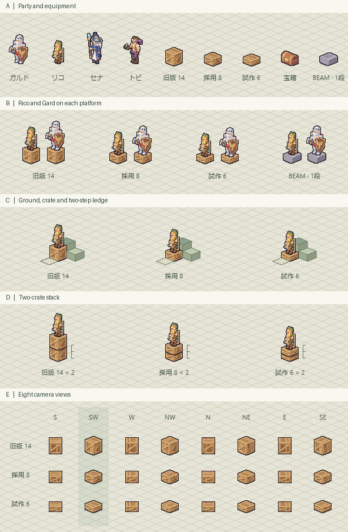
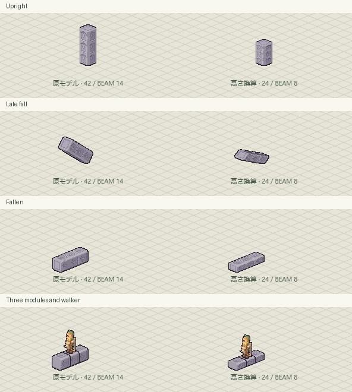

# GUILDWARDの足場と冒険者の寸法基準

**木箱には14×14×8モデル単位を採用する。** 水平の1マスは14×14、鉛直の1段は8。リコとガルドの両足が載る平天板を保ち、2箱の上面が高さ2段の地形と揃う。これはGUILDWARD用の制作基準で、他プロジェクトの寸法は各ゲームで決める。[木箱の公開データ](../docs/assets/wooden_crate/) · [比較画面](../docs/object-study.html?scene=scale) · [機械可読の寸法設定](../docs/studies/objects01/guildward-scale.json)

## 参照した版とゲーム上の単位

実験01-Aで確認したGUILDWARDの公開mainは **v0.2、`aaa4da5f44d1501cd26956266f8c5cb2ad09c292`**。前回と同じコミットを指定して仕様を読んだ。Lab側の旧木箱は `35ae0262335ca87c06716631b36af4ba49e3a1ed` 時点の材質・部位格子、生成コード、仕様を保存した。[ゲームの変更履歴](https://github.com/shioa2006-game/ONE_PROMPT_WORLDS/blob/aaa4da5f44d1501cd26956266f8c5cb2ad09c292/beyond2/CHANGELOG.md) · [旧木箱の保存先](objects01a/baseline/)

| ゲームコード | 読み取った仕様 |
| --- | --- |
| [render.js](https://github.com/shioa2006-game/ONE_PROMPT_WORLDS/blob/aaa4da5f44d1501cd26956266f8c5cb2ad09c292/beyond2/js/render.js) | 基準の投影でタイルは32×16 px、同じXYで1段上がると画面上へ8 px。木箱の既存描画は幅24 px、側面8 px。640×360を2倍表示 |
| [sim.js](https://github.com/shioa2006-game/ONE_PROMPT_WORLDS/blob/aaa4da5f44d1501cd26956266f8c5cb2ad09c292/beyond2/js/sim.js) | 木箱、石・氷のブロック、がれき、BEAMは立てる面。直立した石柱は高さ3段の障害物。転倒後は元マスを空け、倒す方向に最大3マスのBEAMを生成 |
| [main.js](https://github.com/shioa2006-game/ONE_PROMPT_WORLDS/blob/aaa4da5f44d1501cd26956266f8c5cb2ad09c292/beyond2/js/main.js) | 転倒演出は600 ms。ゲームでの演出時間と、占有・支持面を切り替える時点を区別できる |
| [data.js](https://github.com/shioa2006-game/ONE_PROMPT_WORLDS/blob/aaa4da5f44d1501cd26956266f8c5cb2ad09c292/beyond2/js/data.js) | 依頼のマップに木箱や渡り口を塞ぐ岩、報酬の宝箱を配置。物体の用途はマス単位で決まる |

## 3案を同じ条件で比べる

旧版は1マスの幅と1段の高さの両方に14を使っていた。仰角24°、1.50 px/単位の正投影では、底面中央から真上の天板中央までの変位は `高さ × 1.50 × cos(24°)`。旧木箱の側面だけで19.18 pxあり、リコの頭までの高さの56%を占める。旧ゲーム比較画面では別途、14単位を8 pxに写していたため、Labで人物と並べたときにだけ背の高さが目立った。

| 木箱 | Labでの天板の上昇 | LabのSW実画素 | ゲーム共通尺度での上昇 / SW実画素 | 原寸での判断 |
| --- | ---: | ---: | ---: | --- |
| 旧版 14×14×14 | 19.18 px | 30×33 | 14 px / 32×32 | 側面の斜材は読みやすい。2個積むと地形2段より12単位高く、リコの身長を越える |
| 採用 14×14×8 | 10.96 px | 30×25 | 8 px / 32×26 | 天板、天板直下の影、斜材が区別できる。2段積みで地形の目盛りと揃う |
| 試作 14×14×6 | 8.22 px | 30×22 | 6 px / 32×24 | 登りやすく見えるが、特にS/Nでは側板の露出が少なく、低いパレットに見える。2個積んでも地形2段まで4単位足りない |

SW実画素は輪郭と天板の奥行きを含む不透明画素の外接矩形。比較の「共通尺度」では全案を同じ物差しに載せる。「各案の高さを個別に1段へ換算」を選ぶと、3案すべての天板がゲーム画面で8 px上がる。旧版を個別換算した32×26は初回実験の出力と一致する。台帳に掲載する木箱は高さ8の1件。高さ14と6の出力は比較画面の研究用アトラスに収録した。

オークの材質と木目、鉄釘、天板の平桟と面積を継承した。低背案では上下の框を個別に配置し、残った開口に合わせて斜材を切り、上部の釘を新しい天板のすぐ下へ移した。試作を原寸で見て、天板直下に0.5単位の暗い木口を加えた。高さ8は全方向で補強材205画素以上、釘6画素以上、木目18画素以上を残している。[形状の生成](../objects/wooden_crate/build_model.py) · [3案の再構成](objects01a/variants.py)



Aはガルド・リコ・セナ・トビと木箱3案・宝箱・換算BEAM、Bは各案とBEAMに乗るリコとガルド、Cは地面→箱→2段上と隣の1段台、Dは2箱の積み上げ、Eは全8方向。Cの初版では台が木箱の前に重なったため、基準のSWで高い台を箱の奥に置いて足元と側板を見られるようにした。ブラウザでは人物の位置、モデル、カメラ、底面と支持点を切り替えられる。[Lab 2倍](objects01a/lab-comparison-2x.png) · [ゲーム投影 原寸](objects01a/game-comparison-1x.png) · [ゲーム投影 2倍](objects01a/game-comparison-2x.png)

## 冒険者を基準にする

足裏をZ=0とし、静止時の `head` 所有ボクセルの上端までを頭頂高とする。髪・帽子・兜を含み、弓や槌などの武器を除く。測定した範囲25〜36を人物の目安に使う。既存の体格差、衣装、1.50 px/単位の描画密度を保つ。

| 冒険者 | 頭頂高 | 1段8 / 頭頂高 | SWの既存静止画（幅×高さ） |
| --- | ---: | ---: | ---: |
| ガルド | 33.5 | 24% | 33×51 px |
| リコ | 25 | 32% | 21×41 px |
| セナ | 36 | 22% | 27×55 px |
| トビ | 31.5 | 25% | 33×48 px |

リコの弓とガルドの盾が箱からはみ出しても、支持の判定には靴底を使う。リコの両足、ガルドの広い足幅とも、天板の中央に立つと両靴底の全ボクセルが支持域に収まる。ゲーム投影の比較画面では既存人物の原寸シートの足元だけを投影した支持点に置く。人物の身体をゲーム用カメラで焼き直した場合の見え方は、将来の地形と合わせて評価する。

## 座標、投影、支持面の契約

- ゲーム格子 `(i,j,k)` の原点をタイルの底面中央に置き、GUILDWARD制作座標を `(X,Y,Z)=(14i,14j,8k)` とする。足場の底面が既に高さkにあるときは支持高を加える。2箱目は下の箱の天板に置く。すべてのワールド加算・回転後に1回だけ画素を丸める。
- モデルの+Yが正面、+Zが上。カメラと物体のワールドヨーの差 `c−h` から `S / SW / W / NW / N / NE / E / SE`（0, −45, …, −315°）を選ぶ。占有マスと支持点は物体の方位で回す。45°単位のカメラは、ゲームの4近傍の移動・押し方向と独立している。
- Lab標準は正投影24°・1.50 px/モデル単位。ヨーθに対し `r=X cosθ+Y sinθ`、`f=−X sinθ+Y cosθ` とすると画面変位は `(1.5r, 1.5(f sin24°−Z cos24°))`。SWの1マスは対角29.70×12.08 px、1段は10.96 px上がる。
- 現行ゲームの基準に対応するSWは `screenX=16(X−Y)/14`、`screenY=8(X+Y)/14−8Z/8`。他の7方向は同じ床基底をヨー回転する。これは実験用の8方向拡張で、ゲームの将来の仰角やタイルの表示ピクセル数は独立に変更できる。
- ゲーム用シートを立体から焼く場合は、投影の仰角30°、水平密度 `32/(√2×14)` とし、剛体姿勢の決定後、格子のZ原点と間隔に `8/(元モデルの1段×水平密度×cos30°)` を1回掛ける。新木箱は元モデルの1段=8。旧プロファイルの14を新箱に使うと天板が4.57 pxになり、人物の足が約3.43 px浮く。支持点はシートと同じ変換を通す。[投影実装](objects01/game_projection.py) · [プロジェクトプロファイル](../docs/studies/objects01/guildward-scale.json)

| 公開メタデータ | 木箱の値 | 次の足場での使い方 |
| --- | --- | --- |
| `geometry.anchor_model_xyz` / `floor_z` | [0,0,0] / 0 | 底面中央と接地高さ。描画セルのアンカーは別に `neutral.anchor` に保存。木箱は44×44 pxの (22,32) |
| `placement.occupied_tiles` | [[0,0]] | ローカル格子で実際に占有するマス。柱の元マスと倒した先のマスを区別する |
| `support_center_xyz` | [0,0,8] | 立てる上面の中心。石ブロック・氷・がれきも1段なら支持高8を基準にする |
| `support_half_extents_xy` | [6.5,6.5] | 安全に両靴底を置ける実測半幅。石やがれきで角を欠く場合は実在する平面の内側まで狭める。BEAMは[6,6] |
| `stack_pitch_z` | 8 | 積み可能な物体の底面間隔。2段は16。積み重ねを提供しないモジュールでは省略できる |
| `game_support_steps` | 1 | ルール上の支持段数。旧BEAMの公開支持高14も、GUILDWARDの姿勢換算後には8＝1段になる |

## 方針の選択

| 観点 | A　立方体＋従来の圧縮 | B　低いモデルを直接使う | C　水平・鉛直と出力を分離する |
| --- | --- | --- | --- |
| 原寸の見え方 | Labでは側面が大きい | 木箱8は側板と登りやすさを両立 | 同じ元モデルの投影差を比較できる |
| 冒険者との比率 | 同じ箱でも投影で印象が大きく変わる | Labで22〜32%の頭頂高 | 人物の足元と支持面を同一座標に置ける |
| 地形・ゲームルール | 従来出力だけ1段と整合 | 14×14×8の地形で1段 | 段数とモデル長の関係を明示できる |
| 8方向 | 全方位で姿勢後の再投影が必要 | 同じ立体の8方向をそのまま使える | 床基底、物体方位、カメラの相対ヨーを共用 |
| 開閉・転倒・回転 | 斜め姿勢で軸の見かけ長が変わる | 同一Lab尺度の剛体運動を保つ | 元の剛体姿勢と表示上の変形を分けて評価可能 |
| 既存素材 | 旧ゲーム出力を使える | 旧BEAMとの高さに6単位の差 | 旧モデルのみ校正値を指定できる |
| 制作の手間 | 各ゲーム出力を見ながら補正 | 新規足場は設計時に8へ揃う | プロファイルと座標単位を1か所で管理 |
| 組み込み | 圧縮の二重適用に注意が必要 | Labと同じ地形なら直接配置可能 | 配置・支持点を同じ写像で出力できる。派生アトラスの再生成が必要 |

**推奨はB＋C。** 新規の1段足場は高さ8で造形し、ゲームの床・段・既存モデルの換算はプロジェクト設定に集める。人物、宝箱、岩など支持面を提供しない物体は、1段というルールだけで外見の高さを決めない。旧寸法を引き継ぐ例外は、素材IDと由来をプロファイルに残す。

## 石柱とBEAMの比較試作

元の柱は14×14×42。底面の前縁 (0,7,0) を通る−X軸の周りに0〜90°回す。剛体の長さ42は水平の3マス分に一致するが、新基準の「高さ3段」は24である。長さ24の剛体を倒すと横方向に18単位（約1.29マス）不足する。両端の寸法を同一の剛体回転だけで満たすことはできない。



| 表現 | 転倒中・着地時の結果 | 扱い |
| --- | --- | --- |
| 元の42単位の柱をそのまま倒す | 長さと回転が一定。横倒しは自然に3マスだが、直立は新尺度の5.25段、踏面は1.75段。木箱から渡ると足が6単位上がる | 汎用Lab公開素材と剛体の原本として保存 |
| モデルは42、ゲーム表示では姿勢の後にZを8/14倍 | 支点の高さ0と水平位置は固定。直立24、横倒し長42、踏面8。転倒中の長軸は連続的に伸びて見える | GUILDWARD用の比較試作として推奨 |
| 長さ24の剛体を回し、着地で3個のBEAMに切り替える | 回転中は剛体。切替時に先端が18単位進むため、平地の3マス橋で特に目立つ | 一瞬の接触演出や1〜2区画で止まる場合に別途検討 |

姿勢後の換算では角度θでの長軸長が `√((42 sinθ)²+(24 cosθ)²)`。45°では34.2単位で、横倒しに近づくほど伸びる。原寸の52°では右の試作の石材が薄く長く見える。前縁の接地と着地時の人物の足元を優先する候補である。公開の石柱・BEAMを置き換えると従来のLab利用者にもこの変形が入るため、比較出力に限って適用した。

着地後はローカルYの[7,21]、[21,35]、[35,49]を占有し、中心は (0,14)、(0,28)、(0,42)。各中心から高さ8が歩行面。中央部材から切り出したBEAMを1〜3枚並べる。換算後の横倒しと3枚の輪郭の一致率（共通部分／和集合、8方向の最小）はLab試作97.4%、ゲーム投影98.1%。整数画素への丸め、部材ごとの輪郭、石の端部の欠けによる小さな差が残る。[柱の姿勢・中心座標](../objects/stone_pillar/object.json) · [比較アトラス生成](objects01a/build_study.py)

## 宝箱と大岩

| 対象 | Labの実測寸法 / SW実画素 | 現行尺度比較のSW実画素 | 原寸での評価 |
| --- | --- | --- | --- |
| 閉じた宝箱 | 17×11.5×11 / 30×26 | 32×21 | 高さはリコの頭頂の44%。低い木箱と並んでも丸蓋・真鍮帯・留め金が読める。1マスの中心に置くと長手方向が外へ各1.5単位出る。開くと奥の蓋と空の内張りが見える |
| 大岩 | 17×16.5×16 / 28×27 | 29×19 | 高さはリコの頭頂の64%。進路を塞ぐ一塊の岩として天板のある足場と区別できる。SWでは淡い鉱脈が回転し、横方向からも割れ目が床側へ回り込む |

両者は1マスに配置する。上を歩かせる対象には含めず、従来のゲーム比較出力で用いた14単位の鉛直校正を引き継ぐ。宝箱の蝶番、空洞と終端、岩の半径・接地・位相は元のモデル設定を使う。幅が14単位を超える物体を壁や隣接する物体の横に置いたときの遮蔽は、実際のゲームでの採用時に確認する。

## 再生成と検証

リポジトリのルートから実行する。作業用ディレクトリは未使用のものを選ぶ。最初の2行の生成コマンドで木箱単体、次の2行で4素材の回帰と両比較アトラスを再現できる。

```powershell
$py = (Resolve-Path .venv/Scripts/python.exe).Path
$run = Join-Path $PWD ('.phase1/scale-' + [guid]::NewGuid())
& $py -m objects.wooden_crate.build_model --out "$run/model.npz"
& $py -m objects.bake wooden_crate --model "$run/model.npz" --out "$run/wooden_crate"
& $py -m research.verify_objects --out "$run/objects"
& $py -m research.objects01a.verify_scale --out "$run/atlases"
node research/verify_catalog.cjs
```

比較アトラスだけを生成する場合は `python -m research.objects01a.build_study --out <新しい出力先>`、既存のゲーム投影だけなら `python -m research.objects01.game_projection --out <新しい出力先>` を使う。比較図の再撮影では、まず別のターミナルで `python -m http.server 8000 --bind 127.0.0.1 --directory docs` を起動する。PlaywrightとPillowのあるPythonで次を実行する。

```powershell
$browser = 'C:/Program Files/Google/Chrome/Application/chrome.exe'
python -m research.objects01a.browser_check --url http://127.0.0.1:8000 --browser $browser --out "$run/plates"
python -m research.objects01.browser_check --url http://127.0.0.1:8000 --browser $browser --out "$run/gallery"
```

**技術検証。** 4素材288セルを別の出力先で造形から再生成し、PNG・GIFのデコード結果、メタデータ、コマ時間、方向順と照合した。木箱の最小余白は5 px。保証した支持域の全ボクセル、その直上の空間、リコとガルドの左右の実靴底を検査した。元の高さ14の生成コードも保存した格子を再現した。2種類のアトラスを再生成してRGBAと配置情報を照合。旧ゲームの比較アトラスに対しては、旧版木箱の個別換算8セルと他3素材280セルが、各アンカーから同じ位置に同じ画素を描いた。木箱を除く公開147ファイルは作業開始時のGit版と同一。台帳検証は15素材・49シートレイアウトで合格した。[オブジェクト検証器](verify_objects.py) · [寸法と切替の検証](objects01a/verify_scale.py)

**目視・ブラウザ検証。** Chrome 158.0.8127.88で6つの寸法場面を両投影・全8方向で表示し、木箱3案、アンカー、人物の登る位置、柱9姿勢と3モジュールを切り替えた。比較図は原寸と最近傍2倍で撮影した。既存5場面、公開ビューア288セル、単発・ループ再生、キャラクター・モンスター一覧、HTTPと直接HTMLの隊列も確認した。原寸での形状判断は3案の表、変形の判断は柱の比較図を参照。[寸法画面のブラウザ検査](objects01a/browser_check.py) · [既存ビューアのブラウザ検査](objects01/browser_check.py)

実ゲームへの統合時に決める項目は、45°刻みの地形カメラの最終仰角、人物の再投影、柱の伸びを許容するか、障害物で1〜2区画に止まる際の着地演出。この実験では平地と段差の比較を評価対象とした。
