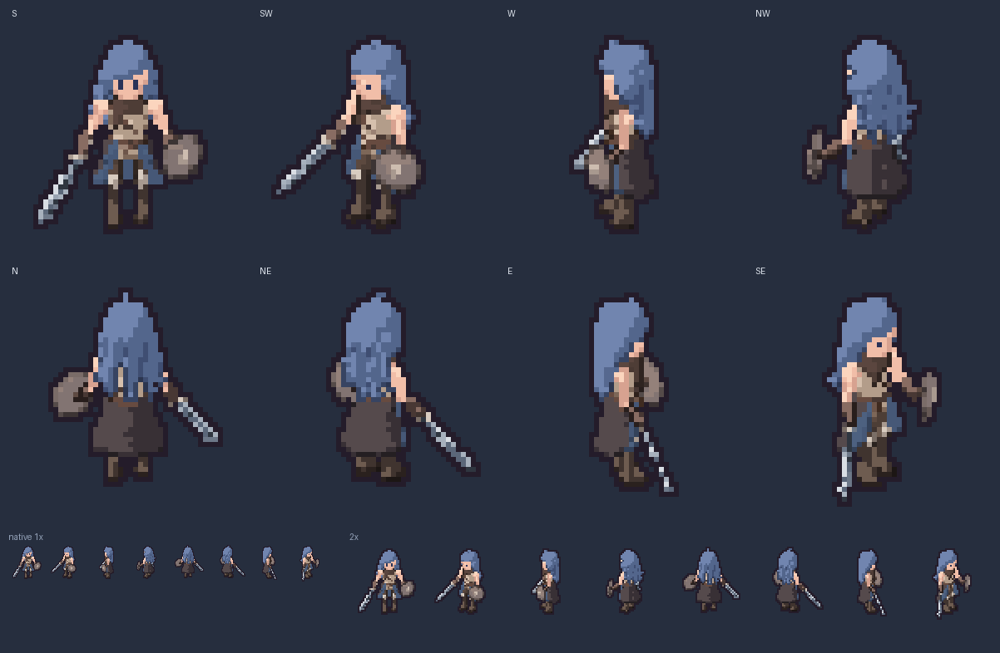
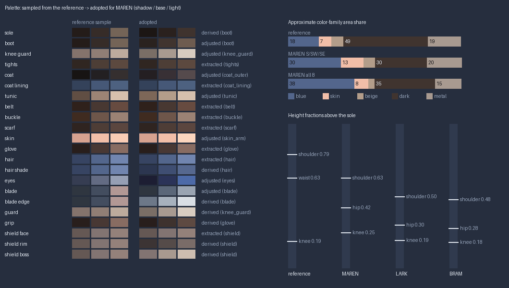
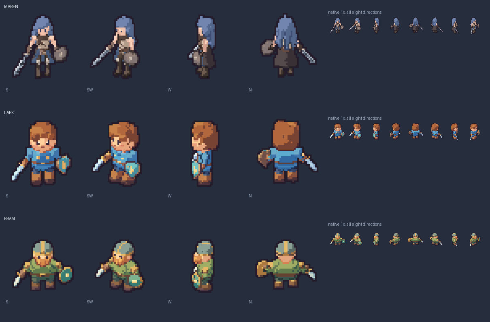

# 画像からのキャラクター自動生成 実験01：MAREN

この記録の動作範囲とCLIの制約は静止制作時点のもの。現行版は静止・歩行・攻撃を生成できる。[現在の制作手順](CHARACTER_CREATION_GUIDE.md) · [完成した攻撃](MAREN_DYNAMIC_SLASH.md)

## 結論

参考イラスト1枚から、青髪の剣士 **MAREN** の材質・部位ボクセルを Python / NumPy で生成し、共通エンジンの描画で静止8方向の透過PNGを作った。共通エンジンのコードは変更していない。LARK・BRAMと同じ17部位リグ、カメラ、48×48セル、足元アンカー (24, 40) を使う。

- **技術面。** モデルの再生成、8方向の配置、余白、装備の左右、公開PNGとの一致を自動検証で確認した。標準CLIは静止・歩行・攻撃をまとめて焼く。MARENでは転用した攻撃の振りかぶりが64 pxセルを越え、何も出力されない。静止だけを共通の描画関数で焼くコマンドを追加した。
- **外見面。** 長い青髪、黒いスカーフ、ベージュの袖なしチュニック、青い裏地の暗い外套、長剣と丸盾を8方向で識別できる。長い脚と細い胴により、LARK・BRAMとは別の体形に見える。一方、風になびく髪の流れ、ニットの畝、表情、細かな傷や金具は48×48では再現できなかった。

[MARENの設定とモデル](../characters/maren/) · [比較資料と計測値](image_to_character/results/) · [公開ギャラリー](https://shioa2006-game.github.io/SpriteStack_Character_Lab/)

## 生成手順

| 段階 | 処理 | 成果物 |
| --- | --- | --- |
| 1. 読み取り | 画像を目視し、材質ごとの採色範囲と縦方向の目印（頭頂、顎、肩、ベルト、裾、膝、足底）を座標で記録 | [reference_regions.json](../characters/maren/reference_regions.json) |
| 2. 抽出 | 範囲内の画素を輝度順に並べ、10–30・45–70・80–95パーセンタイルの中央値を影色・基色・明色にした。色系統の面積比と体の比率も計算 | [extract_reference.py](../characters/maren/extract_reference.py)、[reference_palette.json](../characters/maren/reference_palette.json) |
| 3. 配色 | 22材質のうち抽出色をそのまま採用8、48 px用に調整7、関連色から派生7。理由を材質ごとに記録 | [palette_provenance.json](../characters/maren/palette_provenance.json)、[character.json](../characters/maren/character.json) |
| 4. 立体化 | 楕円体と先細りカプセルを 0.5 単位の 88×56×72 格子に塗り、材質IDと部位IDを同時に決める | [build_model.py](../characters/maren/build_model.py)、`materials.npz`、`part_ids.npz` |
| 5. 描画 | 共通の `Renderer` と `render_neutral` で静止8方向を焼き、CLIと同じ形式のメタデータを出力 | [bake_idle.py](../characters/maren/bake_idle.py)、[idle.png](../docs/assets/maren/idle.png) |
| 6. 検証・比較 | モデル再生成、配置、余白、左右、公開PNGを検査。拡大図、LARK・BRAMとの並び、配色と比率の比較図を生成 | [verify_maren.py](verify_maren.py)、[compare.py](image_to_character/compare.py) |

ルートから実行する。参考画像はリポジトリ外に置き、`$reference` にそのパスを入れる。手順1の座標と手順2の抽出結果は追跡済みのため、画像がなくても手順3以降を再現できる。

~~~powershell
$python = (Resolve-Path .\.venv\Scripts\python.exe).Path
$run = Join-Path $PWD ('.phase1/maren-' + (Get-Date -Format 'yyyyMMdd-HHmmss-fff'))
& $python -B characters/maren/extract_reference.py --image $reference --out (Join-Path $run 'reference_palette.json')
& $python -B characters/maren/build_model.py --out (Join-Path $run 'model')
& $python -B -m characters.maren.bake_idle --out (Join-Path $run 'idle')
& $python -B -m research.verify_maren (Join-Path $run 'idle')
& $python -B -m research.image_to_character.compare --idle (Join-Path $run 'idle') --out (Join-Path $run 'comparison') --reference $reference --local-out (Join-Path $run 'reference_comparison.png')
~~~

`--reference` と `--local-out` を指定すると、参考画像と S・SW・SE の拡大を並べた比較画像も出力する。この画像には参考画像が含まれるため、無視される `.phase1/` に置き、コミットしない。追跡する比較資料は、抽出色、座標、計測値だけから作る。

## 参考画像から抽出・推測・未再現の特徴

参考画像は8.5頭身の写実的な全身像。MARENは約3.3頭身へデフォルメした。肩・膝の高さ比は下表の通り。

| 分類 | 特徴 | MARENでの扱い |
| --- | --- | --- |
| 抽出 | 腰まで届く青い長髪、頭頂のアホ毛、横に流した前髪、顔を縁取る横髪 | 頭部パーツに髪を所属。前髪は髪の外殻を顔の前で斜めに削って表現 |
| 抽出 | 青い瞳 | 1×2 px の暗い紺。抽出した青灰色は髪と区別できず暗くした |
| 抽出 | 首に巻いた黒茶のスカーフと、胸の前に垂れた端 | 胸パーツ。首回りの厚い襟巻きと、本人の右側に垂れる端 |
| 抽出 | 袖なしのベージュのニットチュニック（腿の上部まで） | 胸と骨盤の2パーツに分け、裾は太ももの中ほど |
| 抽出 | 右肩から左腰へのたすき掛けの革帯、二重のベルトと大きなバックル | 胴を斜めに巡る帯、水平のベルトと傾いた腰ベルト、正面のバックル |
| 抽出 | 筋肉質な素肌の腕と、前腕の中ほどまでの革手袋 | 三角筋・上腕二頭筋の膨らみ、前腕の42%から先を手袋 |
| 抽出 | 前の開いた暗い外套、青い裏地、裾の広がり | 骨盤パーツの円錐状の殻。内側の層と前端の折り返しを青い裏地にした |
| 抽出 | 暗いタイツ、膝丈のブーツと銀色の膝当て | 太ももはタイツ、すねはブーツの筒、膝当ては尖った金具の2層 |
| 抽出 | 長い直剣、湾曲した鍔、暗い柄 | 柄から剣先まで約14単位。剣先へ少し幅広になり、両縁を明るい材質にした |
| 抽出 | 灰色の金属の丸盾 | 外向きに傾けたわずかに凸の円盤、暗い縁 |
| 推測 | 後ろ髪の形と長さ | 背中の中ほどまでの5束。外側の右の束を少し外へ流し、風の向きを残した |
| 推測 | 外套の背面、取り付け位置、裾の高さ | ベルト下から背面を閉じ、背中側を最も低い裾にした。浅いひだと緩い波形の裾 |
| 推測 | スカーフの背面、髪に隠れた首と肩 | 首を一周する襟巻き。背面は髪に隠れる |
| 推測 | 盾の外側の面と中央の突起 | 画像では盾の内側と拳が見える。外側の面と突起は推測 |
| 推測 | 足底とつま先 | 画像の下端で靴が切れている。BRAMと同じ形式の靴底を置いた |
| 推測 | 立ち姿 | 画像は踏み出した瞬間。静止はLARKと同じく右足をやや前に出した構え |
| 規約による変更 | 剣と盾の持ち手 | 正面向きとして見ると画像は左手に剣、右腕に盾。指示とプロジェクト規約に合わせ、剣を右手、盾を左手にした |
| 未再現 | 風になびく髪の大きな流れ | 剛体の頭部に固定したまっすぐ垂れる髪束。右側の束の張り出しだけを残した |
| 未再現 | ニットの縦畝、ほつれた外套の端、盾の傷、金具の細部 | 48 pxでは模様が細かな点になるため省略。外套の裾だけ波形にした |
| 未再現 | 表情（眉、口）、筋肉の陰影、鍔のS字と剣先の斜めの切り落とし | 1〜2 px以下になるため省略 |
| 未再現 | 写実的な等身 | 顔と髪を読み取れる頭の大きさを優先した |

## 立体モデル

| 構えの測定 | 参考画像 | MAREN | LARK | BRAM |
| --- | ---: | ---: | ---: | ---: |
| 最高点（モデル単位） | — | 33.0 | 32.0 | 24.5 |
| 肩の高さ ÷ 身長 | 0.79 | 0.63 | 0.50 | 0.48 |
| 股関節の高さ ÷ 身長 | — | 0.42 | 0.30 | 0.28 |
| 膝の高さ ÷ 身長 | 0.19 | 0.25 | 0.19 | 0.18 |
| S方向の外形（px） | — | 35×40 | 38×41 | 38×32 |

参考画像は腰ベルト 0.63。股関節は画像で見えないため空欄にした。LARK・BRAMは関節座標、MARENも関節座標から計算した。

- **部位。** 共通の17部位をそのまま使う。髪は `head`、スカーフとたすき掛けは `chest`、チュニックの裾・ベルト・外套は `pelvis` に所属する。ベルトは胴の後に塗り、正面に残るようにした。
- **材質。** 22材質。各材質を陰影グループに分け、髪と肌、腕と胴、外套と裏地の境界に共通描画の段差線が入るようにした。
- **モーション設定。** 読込に必要なため、歩行はLARKのクリップを共有する。攻撃はBRAMと同じ規則（肩から手へのベクトルを腕のリーチ比で縮尺）で右手の目標を転用した。[攻撃の転用](../experiments/bram/retarget_attack.py)

## 技術的な評価

Windows 11、Python 3.12.1、NumPy 2.3.5、Pillow 13.0.0で確認した。

| 項目 | 結果 |
| --- | --- |
| モデルの再現性 | `build_model.py` で再計算した材質・部位配列がコミット対象のNPZと一致。22材質すべてと17部位すべてにボクセルがある |
| 共通エンジン | `spritestack/` は無変更。設定読込、法線、描画、輪郭、段差線、余白検査を共通コードで実行 |
| 静止8方向 | 384×48 RGBA、8コマすべて異なる。方向順 S、SW、W、NW、N、NE、E、SE。セル48×48、アンカー (24, 40)。不透明度は0か255。全方向で1 px以上の透明余白 |
| 装備の左右 | 剣は本人の右手（x < 0）、盾は左手（x > 0）。S方向で剣は画面左、盾は画面右 |
| 装備と頭の可視画素 | 剣 7〜38 px、盾 17〜66 px、頭 121〜207 px。最小は NW の剣と NE の盾 |
| 公開素材 | `docs/assets/maren/` の PNG とメタデータが、新しく焼いた出力のデコード後RGBA・JSONと一致 |
| 標準CLI | 歩行48コマは余白検査を通過した。攻撃3コマ目（振りかぶり）のSWで停止。剣先が z = 38.0（LARKは 30.8）に達し、SW・Wでは64 pxセルの最上段まで描かれる |
| LARK・BRAMへの影響 | 共通エンジンとLARK・BRAMの設定、モデル、公開素材は無変更（Git差分で確認）。LARKを標準CLIで再生成し、`verify_rebuild.py` でメタデータと正式PNG・部位ID画像5点のRGBAが基準と一致。BRAMは `verify_bram` に合格し、静止・歩行・攻撃のPNGとメタデータが公開素材と一致 |
| ギャラリー | ローカルサーバーで MAREN の8方向、歩行・攻撃ボタンの無効化、LARKへ戻したときの攻撃再生、375 px幅の表示を確認。コンソールエラーなし |

歩行コマは余白の検査だけを通った。接地、髪や外套と脚の重なり、見た目は評価していない。

## 外見の評価

制作者（AI）による目視評価。8方向の拡大図、LARK・BRAMとの並び、参考画像との並び（ローカルのみ）で確認した。

| 観点 | 評価 | 根拠 |
| --- | --- | --- |
| 1. 参考画像との印象の近さ | 概ね良い | 青い髪、暗い外套と脚、ベージュの胴、灰色の剣と盾という配色の構成が残る。抽出色の約3分の1をそのまま使い、くすんだ暖色の画調も保った。デフォルメで頭が大きくなり、正面3方向の青の面積は参考画像の18%に対し30%、暗色は49%に対し30%になった |
| 2. 青い長髪の認識 | 良い | 全8方向で最大の色系統（平均38%）。正面では顔を縁取り、背面では毛束と毛先の分かれが見える。ただし髪は流れずにまっすぐ垂れ、頭巾のような外形に近い |
| 3. 服・スカーフ・装備の識別 | 部分的 | 4倍表示では、スカーフ、チュニック、たすき掛け、ベルト、外套の裏地、剣、盾を見分けられる。原寸では胴の細部が茶色の模様にまとまる。膝当ては1〜2 pxの明るい点にとどまる |
| 4. 体形の区別 | 良い | 肩と股関節の位置が高く、脚が長い。胴と腕も細い。LARKの大頭身、BRAMの低く幅広い体形と並べて一目で区別できる |
| 5. 横・背面の自然さ | 概ね良い | 背面は髪束と裾の広がった外套が連続する。W・Eでは髪の塊が後頭部から背中へつながる。推測した外套の背面は無地で、参考画像の動きは出ていない |
| 6. 8方向の同一性 | 良い | 同じ立体から描画しているため、配色・装備・体形が全方向で一致する。NWの剣とNEの盾は体に隠れて小さい |
| 7. 48×48原寸の魅力 | 概ね良い | 青い長髪、長剣、細長いシルエットで原寸でも読める。LARK・BRAMより彩度と明度が低く、暗い背景では沈みやすい。顔は目の2 pxが中心で、表情は伝わらない |

色系統の面積比は、参考画像の画素を最も近い抽出色へ、スプライトの画素を材質の出典へ割り当てた近似値。

### 調整の経緯

1. 初回は目が髪と同じ青で見えず、顔が小さかった。後ろ髪は平板な塊、チュニックは茶色に見え、外套の裏地はほぼ見えなかった。
2. 目を暗い紺、顔を拡大、後ろ髪を5束、外套の前端を折り返して裏地を表に出した。チュニックの基色を抽出の基色と明色の中間にした。頭頂の光沢帯はヘアバンドに見えたため削除した。
3. 側頭部に髪の量感を足し、肩幅を広げ、外套の裾を広げた。後ろ髪に毛束の溝を加えた。
4. 外套の薄い殻から裏地が点状に透けたため、外層の厚みを 0.75 単位にした。頭頂を下げ、アホ毛を前に倒した。外套に浅いひだを加えた。

## 現行リグの制約と拡張案

| 制約 | 影響 | 必要な拡張 |
| --- | --- | --- |
| リグは17部位と手の装備しか受け付けない（`Biped.__init__`） | 髪と外套が頭・骨盤と剛体で一緒に動く。歩行・攻撃では髪が揺れず、外套を脚が貫通する | 胴体部位に従属する追加部位（例：`hair_back`、`coat_L`、`coat_R`、`coat_back`）。親部位、回転中心、遅れや揺れの角度を設定で持たせる。再スライスは任意の部位列を扱えるため、変更点は姿勢計算と設定検証 |
| 攻撃セルは64×64で固定の契約 | 背が高く剣の長いキャラクターでは、転用した振りかぶりがセルを越える | キャラクター別の攻撃セル（例：72）と契約の更新、または振りかぶりの高さを体格に合わせて抑える転用規則 |
| 標準CLIは3モードを一括で焼く | 1つのモードが失敗すると静止も出力されない | `--modes idle` のようなモード指定。今回は共通コードを変えず、`bake_idle.py` で代用した |
| 攻撃の転用関数がBRAMの設定に固定 | MARENで同じ規則の関数を複製した | `retarget(character_path)` のように設定を引数にする |
| 3階調の陰影で、正面は主に基色になる | 画像から抽出した基色が暗いと、衣装が実物より暗く見える | 抽出色を描画用に補正する規則（輪郭色との明度差、基色の帯域）の自動化 |

## 自動化できた範囲

| 自動 | 人（今回はAI）の判断 |
| --- | --- |
| 採色範囲からの3階調抽出、色系統の面積比、目印からの体の比率 | 画像の特徴の読み取り、材質の分類、採色範囲と目印の座標 |
| 立体モデルの生成、8方向の描画、検証、比較図 | 形状の組み立てと寸法、抽出色の調整、見た目の反復（4回） |

次の段階では、採色範囲の指定と形状寸法の決定を減らすことが課題になる。例として、髪・服・肌の領域分割から範囲を決める方法や、体の比率から関節座標を決める方法がある。

## 権利と追跡

参考画像は第三者の権利を確認できないため、リポジトリに含めず、公開もしない。追跡するのは、画像のSHA-256、採色範囲と目印の座標、抽出した色と計測値、生成コード、生成したPNGだけ。参考画像を並べた比較画像はローカルの `.phase1/` に出力する。

## 未確認事項

- プレイヤーによる印象・魅力の評価と、実ゲームの背景上での視認性。
- MARENの歩行の見た目と接地、攻撃の再設計。
- GitHub Pages への反映は、mainへのpush後に確認する。
