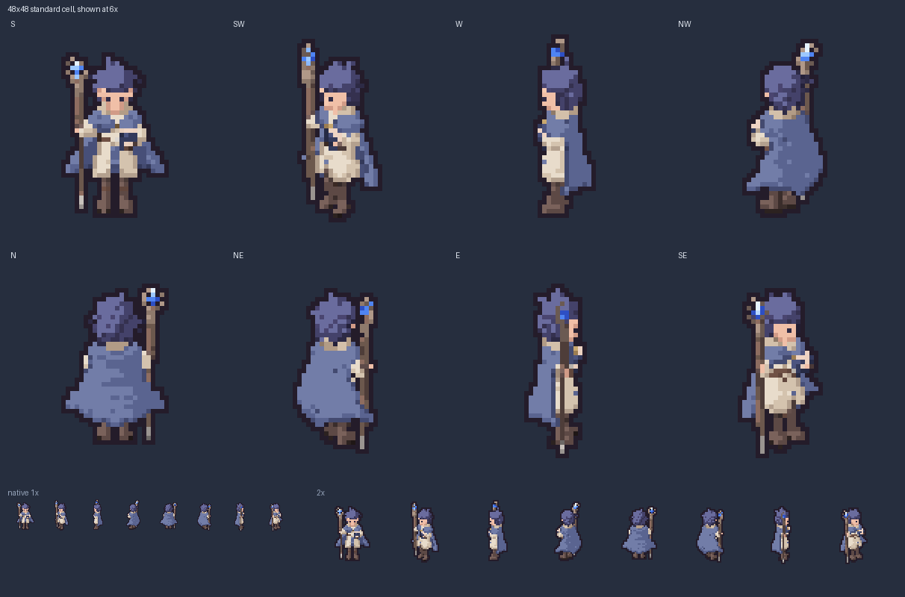
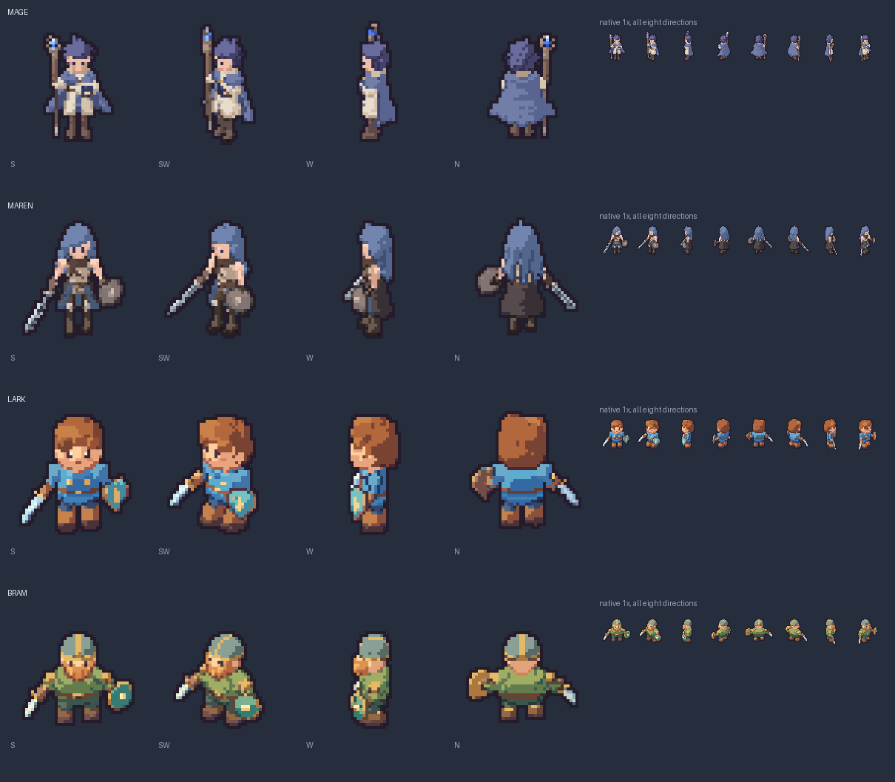
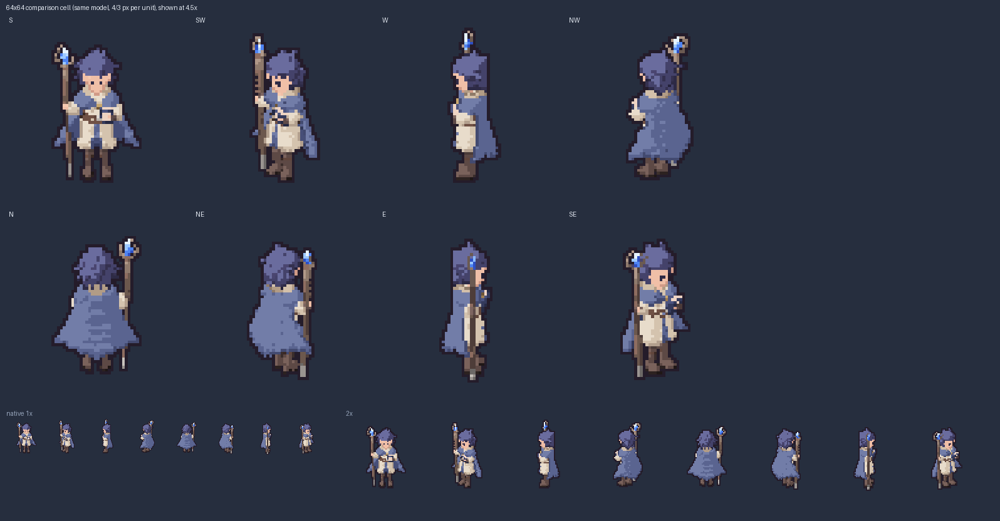
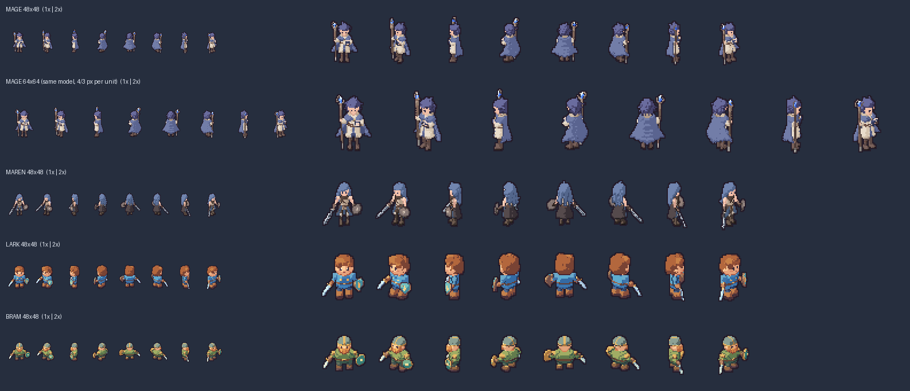
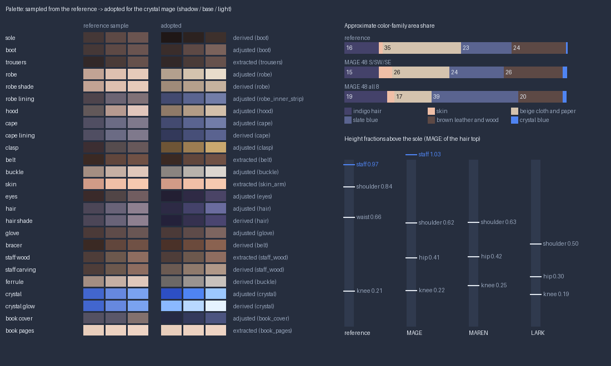

# 画像からのキャラクター自動生成 実験02：CRYSTAL MAGE

この記録の動作範囲とCLIの制約は静止制作時点のもの。現行版は静止・歩行・攻撃を生成できる。[現在の制作手順](CHARACTER_CREATION_GUIDE.md) · [完成した攻撃](CRYSTAL_MAGE_CAST.md)

## 結論

参考イラスト1枚から、水晶の杖と魔法書を持つ若い魔法使い **CRYSTAL MAGE**（仮名 `crystal_mage`）の材質・部位ボクセルを Python / NumPy で生成した。共通エンジンの描画で静止8方向の透過PNGを焼いた。共通エンジンのコードは変更していない。LARK・BRAM・MARENと同じ17部位リグとカメラを使う。剣と盾の取り付け枠に、新しく作った杖と本を取り付けた。

- **技術面。** 自動検証で、モデルの再生成、全体と部位のつながり、杖・本と手の接触、8方向の配置、余白、左右、公開PNGとの一致を確認した。各コマが同じモデルの描画と一致することも確認した。48×48の標準セル（アンカー (24, 40)、1.19 px/単位）に収まる。ただし本人の右側に立てた杖は、W方向で余白1 pxの上限に達した。歩行・攻撃は未実装で、公開していない。標準CLIはLARKの剣の攻撃で杖が姿勢ボリュームを出て止まる。
- **外見面。** 原寸でも、長いベージュのローブ、肩から左右・背面へ広がる青いマント、頭より高い杖と青い結晶が読める。8方向で同じ構成を保つ。髪とマントは参考画像でもほぼ同じ明度の青紫だった。髪を暗い藍色、マントを明るい灰青にし、首回りにベージュのフードを置いて分けた。本は48 pxでは4×4 px前後の紺の塊と1 pxの明るい縁で、本と分かるのは正面3方向が中心。
- **48×48と64×64。** 標準は48×48が適切と判断した。64×64（同じモデルを4/3倍の画素密度で描画）では、結晶の菱形、杖頭の2本の装飾、本の小口、目、ベルトの金具が見分けられる。一方、原寸ではキャラクターが他の3体より33%大きく描かれ、同じ画面に並べると縮尺がそろわない。シルエットと配色の読み取りは48×48でも変わらない。

[設定とモデル](../characters/crystal_mage/) · [比較資料と計測値](image_to_character_02/results/) · [公開ギャラリー](https://shioa2006-game.github.io/SpriteStack_Character_Lab/) · [実験01（MAREN）](IMAGE_TO_CHARACTER_01.md)

## 1. 実験目的

「AIは1枚のキャラクターイラストから外見の特徴を理解し、ゲームで使える8方向の立体ドット絵キャラクターを自動生成できるか」を、剣士だった実験01とは異なる要素で検証する。重点は、長いローブ、大きく広がるマント、背の高い杖、手に持った本、髪型の立体表現、8方向での衣装と装備の一貫性。各方向は共通の立体データから描き、方向ごとの描き分けや左右反転は使わない。

## 2. 参考画像から抽出した特徴

参考画像は537×730 pxの正面向き全身像。白背景に、静かな表情の細身の若い男性が立つ。座標と抽出値は [reference_regions.json](../characters/crystal_mage/reference_regions.json) と [reference_palette.json](../characters/crystal_mage/reference_palette.json) にある。比率は足底から頭頂（髪の先）までの高さに対する値。

| 項目 | 読み取った内容 | 数値 |
| --- | --- | --- |
| 頭身・体形 | 写実寄りの細身。脚が長く肩幅は狭い | 10.3頭身（頭蓋の頂から顎）。肩 0.84、腰ベルト 0.66、膝 0.21、肩幅 0.21 |
| 髪 | 暗い青紫。やや長めで、前髪に動きがあり、側頭部と頭頂の毛先が外へ跳ねる。本人の右側に大きく流れる | 基色 #696378（影 #4c4657） |
| フード | マントとは別のベージュのフードが首の後ろと両脇にたまり、顔とマントの間に見える | 基色 #b69a90 |
| マント | 暗い灰青。両肩を覆い、胸の丸い留め具で閉じる。下は左右と背面へ大きく広がり、裾は尖った端に分かれる | 基色 #6b6b84。左右の端は中心から 0.34〜0.35 |
| ローブ | ベージュの長衣。前身頃が重なり、腰から下は前が割れて青い帯が見える。裾は膝の少し上 | 基色 #dec0b0。裾 0.29、裾の半幅 0.18〜0.19 |
| ベルト | 銀色の四角い留め金の革ベルトと、斜めに下がるもう1本 | 基色 #61463c |
| 脚 | 暗色のズボン、留め帯2本の付いた膝下までの革ブーツ | ブーツ上端 0.20 |
| 手 | 指の出る暗い革手袋と、留め具付きの革の籠手 | — |
| 杖（右手） | まっすぐな木の軸、金属の石突き、輪の彫り。杖頭はねじれた木の枝が青い菱形の結晶を囲む | 長さは身長の 0.97。8°傾く。結晶 0.87〜0.95。握り 0.72 |
| 本（左手） | 暗い灰青の厚い本。胸の前で縦に持ち、上の小口に紙が見える | 本の上端 0.78、下端 0.64 |

左右は規約と一致する。画像を正面向きとして見ると、杖は本人の右手、本は左手にある。

色系統の面積比（白背景を除き、各画素を最も近い抽出色に割り当てた近似値）は、ベージュ（布・紙・金具）35%、茶（革・木）24%、灰青（マント・本）23%、藍（髪）16%、肌 2%、結晶 0.5%。

立体化が難しいと判断した部分は次の通り。

- **風に広がるマント。** 画像は風を受けた一瞬で、静止した立体として成り立つ形が決まらない。
- **髪とマントの同化。** 髪 #696378 とマント #6b6b84 は明度がほぼ同じ。実験01で長髪がフードに見えた問題が再発しやすい。
- **杖頭の装飾。** ねじれた枝は細く、0.5単位のボクセルと48 pxでは潰れる。
- **背の高い杖。** 杖は身長とほぼ同じで、48 pxセルの高さに頭身の大きい体と一緒に収める必要がある。
- **本と手。** 胸の前の暗い本は、暗い手袋と青いマントに埋もれやすい。

## 3. 立体化の方法

| 段階 | 処理 | 成果物 |
| --- | --- | --- |
| 1. 読み取り | 画像を目視し、18材質の採色範囲、縦方向の目印（頭頂、目、顎、肩、留め具、本、ベルト、裾、膝、ブーツ、足底）、杖と幅の座標を記録 | [reference_regions.json](../characters/crystal_mage/reference_regions.json) |
| 2. 抽出 | 実験01の規則で採色範囲の画素から影・基・明の3階調を取り、色系統の面積比と比率を計算。杖の長さ・傾き、幅の比を追加 | [extract_reference.py](../characters/crystal_mage/extract_reference.py)、[reference_palette.json](../characters/crystal_mage/reference_palette.json) |
| 3. 配色 | 25材質のうち抽出色をそのまま採用5、48 px用に調整12、関連色から派生8。理由を材質ごとに記録 | [palette_provenance.json](../characters/crystal_mage/palette_provenance.json)、[character.json](../characters/crystal_mage/character.json) |
| 4. 立体化 | 楕円体、先細りカプセル、曲がった管、超楕円の箱を 0.5 単位の 56×44×66 格子に塗り、材質IDと部位IDを同時に決める | [build_model.py](../characters/crystal_mage/build_model.py)、`materials.npz`、`part_ids.npz` |
| 5. 描画 | 共通の `Renderer` と `render_neutral` で静止8方向を焼く。48×48の標準シートと、同じモデルを4/3倍の画素密度で描く64×64の比較シート | [bake_idle.py](../characters/crystal_mage/bake_idle.py)、[docs/assets/crystal_mage/](../docs/assets/crystal_mage/) |
| 6. 検証・比較 | モデル再生成、つながり、接触、配置、余白、左右、再描画との一致、公開PNGを検査。拡大図、原寸比較、他キャラクターとの並び、配色と比率の図を生成 | [verify_crystal_mage.py](verify_crystal_mage.py)、[compare.py](image_to_character_02/compare.py) |

ルートから実行する。参考画像はリポジトリ外に置き、`$reference` にそのパスを入れる。手順1の座標と手順2の抽出結果は追跡済みのため、画像がなくても手順3以降を再現できる。

~~~powershell
$python = (Resolve-Path .\.venv\Scripts\python.exe).Path
$run = Join-Path $PWD ('.phase1/mage-' + (Get-Date -Format 'yyyyMMdd-HHmmss-fff'))
& $python -B -m characters.crystal_mage.extract_reference --image $reference --out (Join-Path $run 'reference_palette.json')
& $python -B characters/crystal_mage/build_model.py --out (Join-Path $run 'model')
& $python -B -m characters.crystal_mage.bake_idle --out (Join-Path $run 'idle')
& $python -B -m research.verify_crystal_mage (Join-Path $run 'idle')
& $python -B -m research.image_to_character_02.compare --idle (Join-Path $run 'idle') --out (Join-Path $run 'comparison') --reference $reference --local-out (Join-Path $run 'reference_comparison.png')
~~~

`--reference` と `--local-out` を指定すると、参考画像と S・SW・SE の拡大（48と64）を並べた比較画像も出力する。この画像には参考画像が含まれるため、無視される `.phase1/` に置き、コミットしない。

### 部位と描画順

共通の17部位をそのまま使う。リグは手の装備の名前を問わないため、LARKで `sword`・`shield` が入る2枠に `staff`（右手）と `book`（左手）を登録した。`Biped` は設定を受け付け、静止姿勢で装備が手に追従する検査も通る。

| 部位 | 所属する形状 |
| --- | --- |
| `head` | 顔、首、目、髪（頭頂の毛束3本、跳ねた横髪4本、うなじの毛束4本、もみあげ、前髪） |
| `chest` | ローブの胴、前身頃の合わせ目、マント全体、フード、留め具 |
| `pelvis` | ローブの裾、前の割れ目と青い裏地、腰ベルトと留め金、斜めのベルト、ズボンの腰 |
| 脚6部位 | ズボン、ブーツ、折り返しの口、留め帯、足と靴底 |
| 腕6部位 | 広い袖（`upper`、`fore`）、袖口の内側、素肌の前腕、籠手、指の出る手袋 |
| `staff` | 木の軸、石突き、彫りの輪2本、2本のねじれた枝、菱形の結晶と光る芯 |
| `book` | 紺の表紙、背、紙の束（上・下・小口に見える） |

マントは2回に分けて塗る。腰から下の鐘形の部分は腕より先に塗り、袖が前に出るようにした。肩を覆う部分は腕の後に塗り、袖の付け根を隠した。右の拳は杖の後、左の手は本の後に塗り、握っているように見せた。この描画順は静止のボクセルに焼き込まれる。動かす場合の問題は「9. 既存エンジンの制約」に記録する。

### 体の寸法

| 構えの測定 | 参考画像 | MAGE | MAREN | LARK | BRAM |
| --- | ---: | ---: | ---: | ---: | ---: |
| 最高点（モデル単位） | — | 髪 30.5、杖 31.5 | 33.0 | 32.0 | 24.5 |
| 頭身 | 10.3 | 3.7 | — | — | — |
| 肩の高さ ÷ 身長 | 0.84 | 0.62 | 0.63 | 0.50 | 0.48 |
| 股関節の高さ ÷ 身長 | — | 0.41 | 0.42 | 0.30 | 0.28 |
| 膝の高さ ÷ 身長 | 0.21 | 0.22 | 0.25 | 0.19 | 0.18 |
| 杖の高さ ÷ 身長 | 0.97 | 1.03 | — | — | — |
| S方向の外形（48 px） | — | 24×37 px | 35×40 px | 38×41 px | 38×32 px |

MAGEの比は髪の先までの高さ 30.5 で割った。外形は輪郭線を含む。膝の比は参考画像とほぼ同じにした。肩は頭を大きくしたため下がる。頭身の大きいデフォルメでは、杖を参考画像の比のままにすると頭の横で終わり、短く見える。そのため身長の1.03倍とし、結晶を頭頂の高さに置いた。

## 4. 自動生成で成功した点

- **シルエット。** 原寸で「青いマントと長いローブの魔法使いが、頭より高い杖を持つ」と読める。正面ではベージュのローブを、左右へ広がる青いマントが囲む。背面では鐘形のマントが最大の面積になる。
- **髪とマントの分離。** 髪を暗い藍色（基色 #44426a）、マントを明るい灰青（#5a6490）に分けた。首回りのベージュのフードが背面で帯になる。N・NE・NWでも、髪、フード、マントの3層が見分けられる。正面3方向の藍の面積比は15%で、参考画像の16%に近い。
- **杖。** 結晶は8方向すべてで見え、48 pxで4〜7 px、64 pxで8〜13 px。軸は床から結晶まで切れ目なく続き（自動検査）、W・NW以外の6方向で全長が見える。
- **8方向の一貫性。** 同じ立体から描画するため、各コマは公開PNGと一致する。杖と本が描かれる画面側は、3次元の位置を投影した側と全方向で一致した。左右対称な方向の組（SW/SE、W/E、NW/NE）に、片方の反転と同じものはない。
- **共通技術の再利用。** 設定読込、法線、3階調の陰影、段差線、輪郭、余白検査、方向の配置はすべて共通エンジン。新しいコードはモデル生成、静止用のベイク、検証と比較だけ。

## 5. 人間による補完・手動調整が必要だった点

今回、人の手による形状や画素の修正はない。依頼文が条件（左右の持ち手、優先順位、48/64の比較、権利の扱い）を与え、それ以外の判断は制作AI（Claude）が行った。

| 自動（コードの実行） | 制作AIの判断 |
| --- | --- |
| 採色範囲からの3階調抽出、色系統の面積比、比率と杖の長さ・傾き | 特徴の読み取り、材質の分類、採色範囲と目印の座標 |
| 立体モデルの生成、8方向の描画、検証、比較図、計測 | 形状の組み立てと寸法、抽出色の調整、描画順、見た目の反復（10回の焼き直し） |

### 調整の経緯

1. **初回。** マントに細かな斑点が出た。外側の層が1ボクセル未満の厚さで、内側の裏地が点状に透けた。マントは体に沿い、正面では肩掛けに見えた。本は青いマントの前端と重なって読めず、髪は丸い兜のようだった。ローブとフードは肌とほぼ同じ桃色で、顔と胴の区別が弱かった。
2. **マント・髪・配色。** マントを 1.15 単位の厚さにし、外側の層を 0.8 単位以上にした。下へ行くほど左右に大きく広げ、ひだの周期を下げた。頭頂の毛束と跳ねた横髪を太く長くした。ローブを黄みの麻色、フードを一段暗い生成りにした。本を暗い紺にして下げ、少し手前へ傾けた。
3. **64 pxでの杖の切れ。** 比較シートのSで、杖の軸が手の下で消えた。半径 0.42〜0.55 の軸が所々で1ボクセル幅になり、画素の中心が軸の間を抜けた。軸の半径を 0.62〜0.68 に上げた。本は紙の厚みを増し、上端を25°手前へ傾けて上の小口を見せた。
4. **Eの横顔（髪）。** 本人の右側に跳ねた横髪がカメラ側へ突き出し、顔を隠した。横髪を後ろへ流し、顔の前の髪の範囲を広げた。
5. **Eの横顔（杖）。** 杖を体の前（y = 2.4）で握っていたため、Eでは軸が顔の前に重なった。握りを体の横（y = 0.6）に移した。SE・SWでも杖が頭から外れた。
6. **結晶の遮蔽。** 3本の枝が前後から結晶を覆い、48 pxでの見える画素は 2〜5 px だった。枝を外側と内側の2本にし、ねじれを40°に減らした。結晶を大きくして 4〜7 px にした。
7. **最終調整。** マントの左右の広がりを参考画像の端（中心から 0.35）へ寄せた。足の形の計算でNaNが出ていたのを直した。部位のつながりの検査で、肩の1ボクセルがマントを突き抜けて肌色の点になっていたのを見つけ、肩の形を下げた。

## 6. 参考画像から確認できた特徴と、推測で補完した特徴

| 分類 | 特徴 | 扱い |
| --- | --- | --- |
| 確認 | 暗い青紫の乱れた髪、前髪、外へ跳ねる毛先 | 頭頂の毛束3本、横の跳ね4本、前髪の3つの房。頭部パーツに所属 |
| 確認 | ベージュのフード、灰青のマント、胸の丸い留め具 | 首を巻くフードの輪と背面のたまり。マントは肩の覆いと下の鐘形の2段。留め具は青銅色の1〜2 px |
| 確認 | 長いローブ、前の割れ目と青い帯、腰ベルトと銀色の留め金、斜めのベルト | 胴と裾を2部位に分け、割れ目の縁を青い裏地にした |
| 確認 | 広い袖、素肌の前腕、籠手、指の出る手袋 | 袖口が広がる円錐、内側を暗くした。前腕の30〜66%が素肌、60〜90%が籠手 |
| 確認 | 暗いズボン、留め帯付きの革ブーツ | 膝下までの筒、折り返し、留め帯1本 |
| 確認 | 木の軸、石突き、輪の彫り、ねじれた杖頭と青い菱形の結晶 | 軸は直線。石突きは灰色の金属。輪2本、枝2本。結晶は縦長の正八面体で、先端に光る芯を置いた |
| 確認 | 暗い青の厚い本と上の小口 | 紺の表紙と背、紙の束。左手は本の下の外側の角を持ち、指が表紙にかかる |
| 推測 | マントの背面形状 | 肩甲骨から下へ広がる鐘形。背面が最も低く、ふくらはぎの中ほど（z ≈ 4.6）まで届く。浅いひだ5周期 |
| 推測 | マントの左右の広がり | 画像の広がりは風によるもの。静止でも残すため、下へ行くほど横に広がる楕円にした。前端は腕の後ろ（100°）から裾で前へ回り（82°）、角が尖って垂れる |
| 推測 | ローブの後ろ裾 | 前より 0.3 単位高く、後ろがわずかに短い |
| 推測 | 髪の後頭部 | うなじまでの量感と、下向きの毛束4本。フードの上に毛先が重なる |
| 推測 | ベルトの背面 | 腰ベルトは一周、斜めのベルトも一周する |
| 推測 | 本の厚み・背・裏表紙 | 厚さ 1.8 単位。背は体の側。上・下・小口に紙が見える |
| 推測 | 杖頭の立体構造 | 枝を外側と内側に置き、軸の周りに同じ向きへ40°ねじった（外側は後ろ、内側は前へ回る）。結晶は正八面体を20°回した。画像の枝は前後関係が読めない |
| 推測 | 立ち姿と足 | 両足をそろえ、左足をやや外へ開いた。靴底と踵は画像では影になる |
| 推測 | フードの背面 | 首の後ろにたまる厚い布。頭巾として頭にかぶせない |
| 規約・解像度による変更 | 頭身 | 10.3頭身を3.7頭身にした。顔と髪が読める頭の大きさを優先 |
| 規約・解像度による変更 | 杖の高さ | 身長の0.97倍を1.03倍にした。大きな頭の横で杖が短く見えないため |
| 規約・解像度による変更 | 杖の握り位置 | 画像では体の前寄り。E・SE・SWで顔に重ならないよう体の横に移した |
| 未再現 | 風になびくマントの波打ちと、ほつれた裾 | 静止の形で左右に広げ、裾の端を尖らせるだけにした |
| 未再現 | 髪の細い流れ、表情、口、まつげ | 48 pxでは目の1 pxだけ。64 pxでも目は1×2 px |
| 未再現 | 枝のねじれ、本の角、留め具の輪の模様、ブーツの2本目の留め帯、斜めのベルトの垂れた端 | 1 px以下になるため省略 |

## 7. 8方向の品質

制作者（AI）による目視評価。8方向の拡大図、原寸の比較、他キャラクターとの並び、参考画像との並び（ローカルのみ）で確認した。可視画素は、その材質と部位が描かれた画素数（48 px / 64 px）。

| 方向 | 見え方 | 結晶 | 本 |
| --- | --- | ---: | ---: |
| S | 最もよく読める。左に杖、右胸に本、両脇にマント、首にフード | 6 / 13 | 16 / 25 |
| SW | 杖の全長と本の小口が見える。マントの左の広がりが大きい | 6 / 9 | 15 / 24 |
| W | 左を向いた横顔。杖は体の奥にあり、頭の上に杖頭だけが見える。本は胸の前に小さく出る | 5 / 10 | 9 / 12 |
| NW | 背中のマントが大部分。杖頭は右肩の上、左腕の袖が左に出る | 7 / 13 | 4 / 6 |
| N | 髪、フード、マントの3層。杖は右脇に全長が見える | 6 / 13 | 0 / 0 |
| NE | マントの右側と杖の全長。本は体に隠れる | 5 / 10 | 0 / 0 |
| E | 右を向いた横顔。杖が手前にあり、頭の中ほどを縦に横切る | 4 / 8 | 7 / 15 |
| SE | 杖が手前で体の右側に重なる。顔と本は見える | 7 / 11 | 18 / 28 |

- **良い点。** 配色と装備の構成が全方向で変わらない。背面でも髪とマントが一体にならない。杖頭は8方向すべてで青く光る点として残る。
- **弱い点。** Wでは杖頭が頭の真上に出て、頭飾りにも見える。Eでは杖が顔のすぐ後ろを通る。背面は無地のマントが大部分で、情報が少ない。48 pxの本は小さく、本と読めるのは正面3方向が中心。

## 8. 48×48と64×64の比較

64×64は、同じモデルとカメラ角度を 1.5867 px/単位（48の4/3倍）で描いた比較用のシート。アンカーは (24, 40) を4/3倍して丸めた (32, 53)。ギャラリーの「セル解像度」で切り替えられる。

| 観点 | 48×48 | 64×64 |
| --- | --- | --- |
| シルエット（ローブ、マント、杖） | 読める | 読める。差は小さい |
| 結晶 | 2×3 px前後の青と白の点 | 菱形と明るい面が分かる |
| 杖頭の枝 | 1〜2 pxの茶色の塊 | 外側と内側の2本が分かれる |
| 本 | 紺の塊と1 pxの明るい縁 | 表紙、上の小口、指の位置が分かる |
| 顔 | 目の2 px | 目、髪の房、フードの縁 |
| 細部（ベルトの金具、前の青い帯、ブーツの口） | 点になる | 識別できる |
| 他キャラクターとの縮尺 | LARK・BRAM・MARENと同じ 1.19 px/単位 | 同じ距離で33%大きく描かれる |
| セル内の余白 | Wで上端1 px（杖頭） | Wで上端1 px（同じ比で拡大したため） |

原寸で比べると、64×64の改善は主に画素数の増加による。造形の情報は増えていない。マント、ローブ、杖という魔法使いの識別要素は、48×48でも同じように読み取れる。64×64を採用するなら、他のキャラクターも同じ画素密度で焼き直す必要がある。標準は48×48とし、64×64は拡大表示や立ち絵の比較に使う。

48×48の高さの制約も確認した。本人の右側（x ≈ −7）に立てた杖は、Wでは遠い側になり、画面上で約3 px持ち上がる。そのため頂点は z ≈ 31.5 が上限。同じ 1.19 px/単位で64×64セル（アンカー (32, 48)）を使えば、杖を約38単位まで伸ばせる計算になる。今回は依頼の「解像度を上げた比較」を優先し、この形式は作っていない。

## 9. 既存エンジンの制約

| 制約 | 今回の影響 | 必要な拡張 |
| --- | --- | --- |
| 48 pxセルとアンカー (24, 40) の高さ | 杖の頂点が z ≈ 31.5 に制限された。体を約30単位に抑えた | キャラクター別の静止セル（例：48×56）、または足元の余白を詰めたアンカー |
| 装備は手の2枠だけ（`Biped.__init__`） | 杖と本は剣・盾の枠に入った。背中の鞘、腰の本、杖の持ち替えは表現できない | 部位を親に従属させる一般的な取り付け（親部位、取り付け点、回転） |
| 攻撃クリップの語彙が剣と盾（`blade`、`shield_delta`、`weapon_axis`） | 杖の攻撃（突き、掲げる、詠唱）を既存の転用規則で作れない | 装備の軸と目標姿勢を装備ごとに定義するクリップ形式 |
| 標準CLIは3モードを一括で焼く | LARKの剣の攻撃を読込用に参照したところ、31単位の杖が3〜5コマ目に姿勢ボリュームの外（x ≈ −25）へ出た。8コマ目に床下（z = −2.0）へ入り、何も出力されずに止まった。歩行の6姿勢はボリュームに収まったが、描画と評価はしていない | `--modes idle` のようなモード指定（今回は `bake_idle.py` で代用） |
| 衣装と髪は剛体部位に所属 | 静止は問題ない。歩行では、胴に所属するマントの鐘形が脚と重なる。骨盤に所属するローブの裾も腿の回転を受けない | 下記 |
| 描画順の焼き込み | 静止では「鐘形→腕→肩の覆い」の順で塗った結果がそのまま出る。動かすと、再スライスは `rig.parts` の順で後の部位が勝つ。胸（マント全体）は腕より前なので、腕が肩の覆いを突き抜ける | 肩の覆いを腕の後に並ぶ独立部位にする。重なりの優先を部位対ごとに設定できる再スライス |
| 0.5単位のボクセル | 細い軸（半径0.5未満）が所々で1ボクセル幅になった。64 pxでは画素の中心が軸の間を抜けて切れた | 細い装備は半径0.6以上。装備だけ細かい格子で持つ多重解像度 |
| 3階調の陰影と自己発光なし | 結晶の光は、どの面でも明るい材質で近似した | 発光材質（陰影を受けない色）や、輪郭色の局所的な変更 |

### マントや裾を動かす場合の研究課題

1. **従属部位への分割。** マントを `cape_mantle`（肩の覆い）、`cape_L`、`cape_R`、`cape_back`、ローブの裾を `skirt_front_L/R`、`skirt_back` に分ける。各部位に親（胸・骨盤）、回転中心（肩の線・腰の線）、可動範囲を持たせる。
2. **遅れと揺れ。** 歩行の位相に対して、親の回転を数コマ遅らせて減衰させる。2次の揺れの角度を設定に置く。共通の再スライスは任意の部位列を扱えるため、変更点は姿勢計算と設定検証になる。
3. **脚との干渉。** 裾の内側と腿・すねの最短距離を計測する。貫通する姿勢では裾を外へ開く制約を置く。BRAMのウェイト試作（Phase 4）の局所補間を、裾の縦方向の変形に使えるか調べる。
4. **描画順。** 部位ごとの重なり優先（腕が勝つ、肩の覆いが勝つ）を明示できるようにする。
5. **評価。** マントの輪郭が方向とコマで不自然に跳ねないかを、輪郭の画素差で計測する。

## 10. 今後の改善候補

- 杖の攻撃と詠唱の静止ポーズ。杖を掲げる、前へ突き出すなど、装備の軸から作るクリップ。
- 歩行の評価。マントと裾を従属部位に分け、脚との干渉と揺れを検証する。
- 本の読みやすさ。表紙の金具や留め帯を1 px加える。開いた本を持つ差分ポーズの比較。
- 背面の情報。マントの背に模様や縫い目を入れるか、フードを大きくするかの比較。画像にない要素の追加になるため、根拠を記録する。
- 画像からの自動化。採色範囲の指定（今回18材質）と寸法の決定を、領域分割と比率の推定で減らす。今回の手動の判断（頭身、杖の高さ、握り位置）は、規則として書き出せる。
- 48 pxセルの高さの見直し。背の高い装備を持つキャラクターのために、静止セルの高さかアンカーを調整できるようにする。

## 技術検証

Windows 11、Python 3.12.1、NumPy 2.3.5、Pillow 13.0.0で確認した。

| 項目 | 結果 |
| --- | --- |
| モデルの再現性 | `build_model.py` で再計算した材質・部位配列がコミット対象のNPZと一致。25材質と17部位すべてにボクセルがある。「抽出」とした5材質の3階調は抽出結果と一致 |
| リグと装備 | `Biped` が `staff`（hand_R）と `book`（hand_L）を受け付け、静止姿勢で装備が手に追従する。目印 `staff_tip`、`book_center` は各装備の範囲内 |
| つながり | モデル全体が26近傍で1つにつながり、浮いた小片はない。杖は右の拳と合わせて床（z = 0）から頂点（z = 31.5）まで切れ目がない。杖と右手の接触14ボクセル、本と左手19、手と前腕、前腕と上腕、上腕と胸も接触する。部位内の分断は腿の1ボクセル（骨盤の内側）と上腕の7・14ボクセル（肩の覆いで分かれた袖）。どれも他の部位に接し、3ボクセル未満の小片は16枚の描画のどこにも出ない |
| 左右 | 杖は本人の右（x < 0）、本は左（x > 0）。描かれた画面側が3次元の位置の投影と一致（投影が中心から2 px以上離れる方向で検査）。S：杖が左、本が右。N：杖が右 |
| 48×48 | 384×48 RGBA、8コマすべて異なる。方向順 S、SW、W、NW、N、NE、E、SE。アンカー (24, 40)。不透明度は0か255。全方向で1 px以上の透明余白（Wの上端がちょうど1 px）。各コマが共通の描画関数による再描画と一致。SW/SE、W/E、NW/NEの片方の反転は他方と一致しない |
| 64×64 | 512×64 RGBA。アンカー (32, 53)。48×48と同じ検査に合格 |
| 可視画素 | 結晶は8方向すべてで48 pxで4〜7 px、64 pxで8〜13 px。本は S、SW、W、SE で48 pxで9〜18 px |
| 公開素材 | `docs/assets/crystal_mage/` の PNG と JSON が、新しく焼いた出力のデコード後RGBA・JSONと一致 |
| 標準CLI | 攻撃の姿勢で杖が姿勢ボリュームを出て止まる（9. を参照）。歩行・攻撃は公開しない |
| LARK・BRAM・MARENへの影響 | 共通エンジン、既存キャラクターの設定・モデル、既存の公開素材はGit差分なし。LARKを標準CLIで再生成し、`verify_rebuild.py` でメタデータと正式PNG・部位ID画像5点のRGBAが基準と一致（PNGのバイトは従来通り一致しない）。BRAMは標準CLIの出力が `verify_bram` に合格し、静止・歩行・攻撃のPNGとメタデータが公開素材と一致。MARENは `bake_idle` の出力が `verify_maren` に合格 |
| ギャラリー | ローカルサーバーで、CRYSTAL MAGEの48・64の8方向、歩行・攻撃ボタンの無効化と注記、LARKへ戻したときの攻撃再生、375 px幅で横スクロールがないことを確認。コンソールエラーなし |

## 配色

正面3方向の面積比は、藍の髪 15%（参考画像 16%）、灰青 24%（23%）、茶 27%（24%）、ベージュ 26%（35%）、肌 6%（2%）。ベージュが少ないのは、頭を大きくして脚と装備の比率が上がったため。肌が多いのも頭の拡大による。8方向の平均では、背面のマントにより灰青が39%になる。面積比は、スプライトの各画素を材質の出典の色系統に割り当てた近似値。

## 権利と追跡

参考画像は第三者の権利を確認できないため、リポジトリに含めず、公開もしない。追跡するのは、画像のSHA-256（`dcbabdd4…`）、採色範囲と目印の座標、抽出した色と計測値、生成コード、生成したPNGと計測だけ。参考画像を並べた比較画像はローカルの `.phase1/` に出力する。

## 未確認事項

- プレイヤーによる印象・魅力の評価と、実ゲームの背景上での視認性。
- 歩行・攻撃の見た目。歩行の6姿勢はボリュームに収まることだけ確認し、描画と余白、マントと脚の干渉は評価していない。
- 64×64セルを同じ 1.19 px/単位で使い、杖を伸ばす形式の見た目。
- GitHub Pages への反映は、mainへのpush後に確認する。
