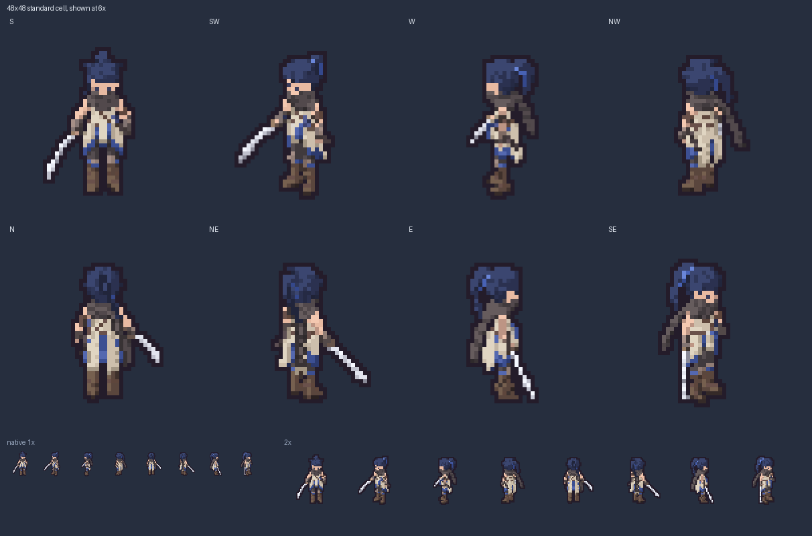
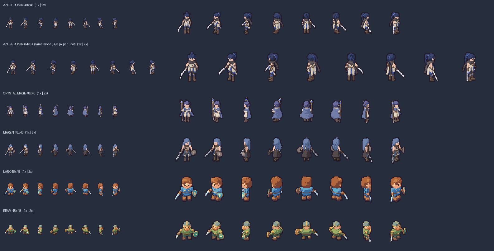
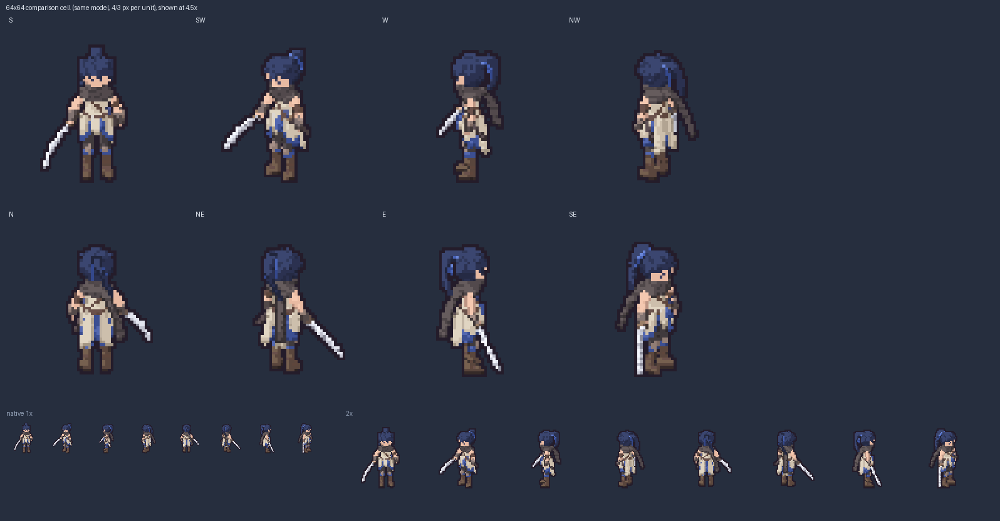
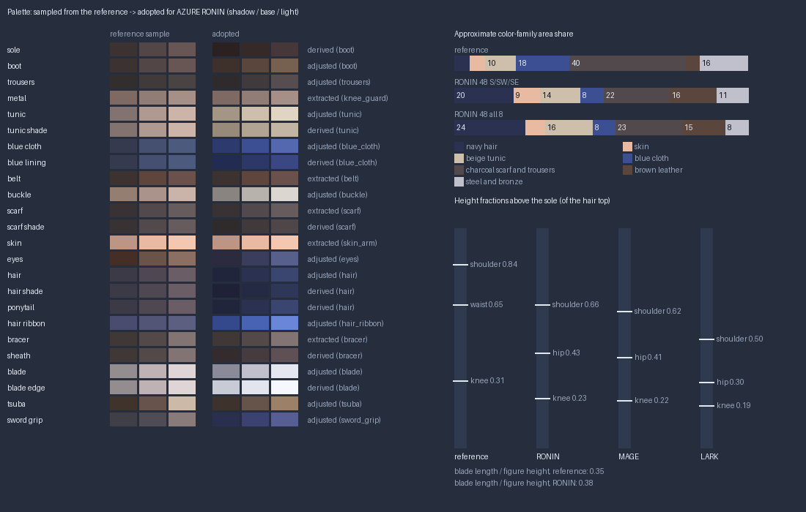

# 画像からのキャラクター自動生成 実験03：AZURE RONIN

## 結論

参考イラスト1枚から、高い位置で髪を束ね、口元を濃色のスカーフで隠した軽装の剣士 **AZURE RONIN**（`azure_ronin`）を作った。モデルは Python / NumPy で材質・部位ボクセルとして生成した。静止8方向は共通CLIの `--modes idle` で焼き、品質は汎用検証 `research.verify_character` で確かめた。共通化後の最初のキャラクターで、`bake_idle.py` と `verify_<name>.py` は作っていない。共通エンジンと汎用検証のコードも変更していない。

- **技術面。** 汎用検証は48×48と64×64の両方で PASS 64、WARNING 0、FAIL 0、SKIP 0。部位の切れ端も迷い画素もない。内容は次の4点。
  - モデルと装備：再生成の一致、つながり、剣と右手の接触、剣の左右。
  - 配置と描画：8方向の配置と余白、各コマと再描画の一致。
  - 可視画素：スカーフ・ポニーテール・剣・衣装の層。
  - 公開素材との一致。
- **剣の途切れ。** 刀身は16枚の描画すべてで画面上1つながり。比較スクリプトで、刀身画素の8近傍の塊の数を数えて確認した。初めは刀身が薄く、S方向で2つ、E方向で3つに切れていた。
- **外見面。** 原寸でも「青系の髪を束ねた、顔を隠した、軽装の剣士」と読める。
  - 正面3方向：紺の髪と頭頂の束、目の1列、その下の濃灰のスカーフ、白〜ベージュの上衣と青い差し色、濃色のズボン、反りのある片手剣。
  - 側面と背面：頭から離れて弧を描くポニーテールと、後ろに垂れるスカーフの端。
- **残る弱点。**
  - 頭頂の束は正面で小さな尖りに見え、参考画像の「後頭部で束ねた髪」より冠のように見える。
  - 結び紐、腰の短い刀、胸の帯は1〜10 pxの差し色にとどまる。
- **共通化の効果。** 静止のベイクと品質検証にキャラクター用のコードが不要になった。品質の条件は42行の `quality.json` で書けた。仮の条件で1回測り、測定値の半分程度を下限にする流れで決まった。一方、形と色の判断は従来どおり個別に必要だった。
  - 個別だった作業：画像分析、採色、`build_model.py`（287行）、8回の目視調整、検査の方向としきい値の選択。
  - 新たに個別の判断が要った点：画面上の刀身の切れは汎用検証では検出できなかった。ポニーテールを数えるため材質を分ける必要があった。

[設定とモデル](../characters/azure_ronin/) · [比較資料と計測値](image_to_character_03/results/) · [公開ギャラリー](https://shioa2006-game.github.io/SpriteStack_Character_Lab/) · [実験02（CRYSTAL MAGE）](IMAGE_TO_CHARACTER_02.md) · [制作ガイド](CHARACTER_CREATION_GUIDE.md)

## 1. 実験目的

「共通化した制作基盤を使って、参考画像1枚から新しい立体キャラクターを効率よく制作できるか」を検証する。

1. 参考画像から特徴を抽出し、静止8方向キャラクターを生成できるか。
2. 共通CLI（`--modes idle`）と汎用検証（`research.verify_character`）だけで、個別のベイク・検証コードなしに制作できるか。
3. 既存2作品と異なる形状を表現できるか。高い位置の髪束、顔を覆う大きなスカーフ、長く流れる布、和風の片手剣、腰まわりの布の重なり。
4. 48×48原寸でキャラクター性が読めるか。

方向ごとの描き分けや左右反転は使わず、各方向を同じ立体モデルから描く。

## 2. 参考画像から抽出した特徴

参考画像は556×738 pxの全身像（WebP。採色はPNGに変換した同じ画素で行った）。白背景に立つ若い男性で、体は少し画面左へ、顔は画面右へ向く。座標と抽出値は [reference_regions.json](../characters/azure_ronin/reference_regions.json) と [reference_palette.json](../characters/azure_ronin/reference_palette.json) にある。比率は足底から頭頂（髪の先）までの高さに対する値。

| 項目 | 読み取った内容 | 数値 |
| --- | --- | --- |
| 頭身・体形 | 細身で手足が長く、俊敏そう。写実寄り | 9.4頭身（頭蓋の頂から顎。顎はスカーフの下で推定）。肩 0.84、腰ベルト 0.65、膝 0.31、肩幅 0.21 |
| 髪 | 暗い紺〜青紫。前髪と横髪が乱れ、後頭部の高い位置で束ねる。束から長い髪と2本の青い結び紐が画面左（本人の右）へ流れる | 束の高さ 0.97。毛先は中心から 0.13（画面左） |
| スカーフ | 濃い灰色の大きな布。鼻から下の顔を覆い、首と両肩に厚く巻く。端は画面左へ大きくなびく | 上端 0.90（目 0.92）、下端 0.81。端は中心から 0.36 |
| 上衣 | 白〜薄ベージュの袖なしの上衣。汚れの灰色が多い。斜めの革帯が本人の右肩から左腰へ、内側の青い襟が見える | 抽出の基色 #af9990（汚れ込み） |
| 腰まわり | 濃色の帯、金具のある革ベルト、青い帯の結び目。下は前に尖った前掛け、左右と後ろに長い裾。裾の裏と間の布は青い。本人の左後ろの裾が大きく広がる | 前掛けの先 0.49、長い裾の先 0.23。裾の端は中心から 0.38 |
| 下半身 | 濃い灰色の太いズボン、右膝に金属の膝当て、脛に青い布、留め帯の付いた長靴 | 膝 0.31、脛の布 0.20、長靴の上端 0.18 |
| 腕 | 上腕は素肌。本人の左上腕に革の腕輪。肘から手まで暗い手甲と金属板、指なし手袋 | — |
| 主装備 | 本人の右手に、反りのある細身の片手剣。刃先を下・外へ向けて低く持つ | 刀身 0.35、柄 0.13、反り（弦に対する矢高）2.6%、弦の傾き 27.6°、切っ先の高さ 0.19 |
| 副装備 | 左手は空。本人の左腰に、短い刀の柄が上を向いて差してある。腰の袋に手裏剣 | — |

参考画像の色系統の面積比（近似）は、濃灰（スカーフ・ズボン・手甲）40%、青い布 18%、鋼・青銅 16%、ベージュ 10%、紺の髪 5%、肌 5%、茶の革 5%。鋼が多いのは、刀身の明色が背景近くの淡い灰色にも割り当たるため。

### 立体化が難しい部分

| 課題 | 難しさ |
| --- | --- |
| A：顔を覆うスカーフ | 顔の露出は目の周りの細い帯だけ。48 pxでは目とスカーフの間が1 px前後しかない |
| B：ポニーテールと長い布 | 髪束、結び紐、スカーフの端、裾がどれも後ろへ流れる。同じ方向の細長い形が重なり、背景の雑音にも見えやすい |
| C：和風の細身の剣 | 刀身の幅は身長の約4%。反りの矢高は0.3単位で、ボクセル1個（0.5単位）より小さい |
| D：多層の衣装 | 白い上衣、青い布、濃いズボン、帯が重なる。48 pxでは1つの白い塊になりやすい |
| 配色の衝突 | スカーフ #52494c、手甲 #534949、長靴 #534646 がほぼ同じ灰色。髪の抽出色 #4f4853 も灰紫で近い |
| 風 | 髪、紐、スカーフの端、裾が風になびいた一瞬の形。静止姿勢の8方向では、どの向きにも同じ形で見える必要がある |

## 3. 立体化の方法

| 工程 | 自動・手動 | 内容 |
| --- | --- | --- |
| 1. 画像分析 | 制作AIの判断 | 20 px格子の2倍拡大と部分拡大を見て、特徴、比率、左右、難所を表にした |
| 2. 採色範囲 | 制作AIの判断 | 20材質の範囲と15の高さの目印、剣の4点、幅の6点を座標で記録し、確認図を目視した |
| 3. 色と比率の抽出 | 自動 | `characters.azure_ronin.extract_reference`。3階調の規則は実験01の `extract` を共有し、剣の長さ・反り・傾きの計算を足した |
| 4. 設定とモデル | 制作AIの判断 | `character.json`（配色24材質、関節、装備1つ、64比較の `comparison_view`）と `build_model.py` |
| 5. 静止のベイク | 自動（共通CLI） | `python -m spritestack --character characters/azure_ronin/character.json --modes idle --out <出力先>` |
| 6. 目視の調整 | 制作AIの判断 | 局所の確認用スクリプト（`.phase1/`、追跡しない）で8回焼き直した |
| 7. 品質検証 | 自動（汎用検証） | `quality.json` を書き、`python -m research.verify_character` |
| 8. 比較図と計測 | 自動 | `research.image_to_character_03.compare`（実験02の比較スクリプトを複写し、刀身の塊の数などを追加） |

~~~powershell
& $python -B -m characters.azure_ronin.extract_reference --image .phase1/azure_ronin/reference.png --out characters/azure_ronin/reference_palette.json
& $python -B -W error::RuntimeWarning characters/azure_ronin/build_model.py --out characters/azure_ronin
& $python -B -m spritestack --character characters/azure_ronin/character.json --modes idle --out $run/idle
& $python -B -m research.verify_character --character characters/azure_ronin/character.json --out $run/idle
& $python -B -m research.image_to_character_03.compare --idle $run/idle --out research/image_to_character_03/results
~~~

### 部位と描画順

共通の二足リグの体15部位に、装備1つ（`sword`、右手）を加えた16部位。左手は空なので、取り付け枠を1つだけ使った。共通リグは取り付け枠の数を固定していない（`Biped.__init__`）。部位IDの1〜15は他のキャラクターと同じで、16が主装備。盾・本に当たる17番はない。

| 形状 | 部位 | 描画順の意図 |
| --- | --- | --- |
| 脚、膝当て、脛の青い布、長靴と留め帯 | 腿・脛・足 | 最初。脛の青い布は長靴の上端のすぐ上 |
| ズボンの尻、青い下層の裾、ベージュの上層の裾（前掛け・左右・後ろ2枚）、ベルト、金具、青い帯の結び目と2本の端 | `pelvis` | 下層の青を先に塗り、ベージュの上層を外側に重ねる。上層の隙間から青が見える |
| 腰の短い刀（柄、鍔、鞘） | `pelvis` | 裾の後に塗り、鞘が裾の上に出る |
| 袖なしの上衣、青い襟、斜めの革帯 | `chest` | 革帯は前と背中の両方で、右肩から左腰へ |
| スカーフの端（後ろに垂れる帯） | `chest` | 腕の前に塗り、右腕が手前に残る |
| 腕：素肌の上腕、左上腕の腕輪、手甲と金属板 | 腕6部位 | — |
| スカーフの首巻きと肩掛け | `chest` | 腕の後に塗り、肩の上を覆う |
| 首、頭、髪、前髪・横髪、目、ポニーテール、結び紐 | `head` | ポニーテールは髪と同じ色の別材質・別陰影グループで、頭と重なる境界に段差線が入る |
| スカーフの口覆い、しわ | `head` | 顔と一緒に動く部分なので頭部に所属させた |
| 剣（刀身、刃側の線、鍔、柄、柄頭）と右の拳 | `sword`、`hand_R` | 拳を剣の後に塗り、柄を握って見えるようにする |
| 空の左手 | `hand_L` | 手袋の甲と、下に垂れる素肌の指 |

### 体の寸法

頭蓋の頂から顎までを7.5単位にした（CRYSTAL MAGEと同じ頭）。頭頂（ポニーテールの束）は z = 29.0、約3.7頭身で、参考画像の9.4頭身から頭を大きくした。

| 位置 | 参考画像（足底から） | AZURE RONIN | 判断 |
| --- | --- | --- | --- |
| 肩 | 0.84 | 0.66 | 頭を大きくした分、肩が下がる |
| 腰ベルト／股関節 | 0.65 | 0.43（股関節）、ベルトは z = 14.6〜15.3（0.50〜0.53） | CRYSTAL MAGEと同じ胴と脚 |
| 膝 | 0.31 | 0.23 | 脚は頭身の変更で短くなる |
| 刀身の長さ | 0.35 | 0.38（11.1単位） | 参考画像の比率に近い長さ |
| 刀身の反り（矢高／長さ） | 2.6% | 7.6%（0.85単位） | 0.5単位のボクセルで見えるよう誇張 |
| 切っ先の高さ | 0.19 | 0.13（z = 4.4） | 低く構えた形を保つ |
| スカーフの端の最下点 | 風で横へ | z = 9.5（腰の下） | 静止のため後ろへ垂らした |
| 後ろの長い裾 | 0.23 | z = 6.5（0.22） | ほぼ同じ |

48 pxセルの余白は最小5 px（S、SW、W、SE）、64 pxセルは最小7 px。高さの予算（上端 `0.9135·z + 0.4067·d ≤ 31.5`）に対して余裕があり、頭や装備をこれ以上高くしなくても余白は確保されている。

## 4. 自動生成で成功した点

- **共通CLIで最初から静止8方向が焼けた。** ベイクのコードを書かずに、`--modes idle` で48×48の標準と64×64の比較が出た。
- **汎用検証で1回目から全項目を実行できた。** 下書きの `quality.json`（全方向・下限1 px）で可視画素を測った。その値の半分程度を下限にして最終設定を作った。モデル・リグ・シートの検査には、キャラクター固有のコードがいらない。
- **共通部品の組み合わせで新しい形が作れた。** 楕円体、カプセル、曲がった管、角度で切った殻で作った形は次の通り。
  - 頭から離れて弧を描くポニーテール
  - 平たい帯のスカーフの端
  - 角度ごとに裾の長さが違う2層の裾
  - 2次曲線で反らせた刀身
- **全モードの標準CLIも止まらずに焼けた。** 画像由来のキャラクターでは初めて。剣を右手に持ち、左手に装備がないため、LARKの攻撃の姿勢でも装備が姿勢ボリュームを出なかった。ただし歩行・攻撃はLARKのクリップのまま調整も評価もしていないので、公開しない。

## 5. 人による補完・調整

| 内容 | 自動の処理 | 制作AIの判断 |
| --- | --- | --- |
| 採色範囲 | 範囲内の色の分位で3階調 | 範囲の座標、小さい部位の絞り込み（青い結び紐・脛の布は彩度の高い青だけ） |
| 配色 | 抽出5材質をそのまま使用 | 24材質のうち11を調整、8を派生。髪を灰紫から紺へ、上衣を汚れの灰色から明るいベージュへ、長靴を灰色から茶へ、青い布の彩度を上げた |
| 形 | なし | 部位の形と寸法、描画順、関節の位置、剣の向き |
| 検証の条件 | 測定値の出力 | 見えるべき方向（NWの剣は自然な遮蔽として別扱い）、下限、警告扱い（結び紐） |

### 調整の経緯

| 回 | 見つけた問題 | 原因 | 直し方 |
| --- | --- | --- | --- |
| 1 | 髪が明るい青の帽子に見える。背面にポニーテールが見えない。裾がズボンを隠し、下半身が白い | 髪の明色が明るすぎた。束と尾が髪の殻の内側に埋まった。青い下層が前まで一周していた | 髪を暗い紺へ。ポニーテールを別の陰影グループに |
| 2 | 側面で尾が見えた。目が見えない。頭頂が円錐。ズボンがまだ少ない | スカーフの上端が目の高さまで来た。束が上へ伸びた | スカーフの上端を z = 22.9 へ下げ、目を少し上げた。裾の前を開け、前掛けを細くした |
| 3 | Wで剣が2 pxしか見えない | 刀身が体と脚の後ろに隠れた | 切っ先を前（y）へ出した |
| 4 | 背面が白い1枚の板。Sの頭頂がまだ尖る | 後ろの裾が1枚 | 後ろの裾を2枚に分け、中央の隙間から青を見せた |
| 5 | 頭頂の尖り | 上向きの毛束と束 | 上向きの毛束を除き、横へ跳ねる毛束を足した。束を下げ、尾を本人の右へ流した |
| 6 | スカーフの端が背面で目立たない | 端が細い管 | 体の面に沿って2本並べ、幅2.4単位の平たい帯にした。64 pxの比較を焼いた |
| 7 | 上衣が白すぎてまぶしい | 明色が高い | ベージュに寄せて明度を下げた |
| 8 | 比較の計測で、刀身がSで2つ、Eで3つに切れる | 刀身の厚さ0.6単位。刃を横から見る方向で1 px未満の線になる | 厚さを0.9単位、幅を最大1.12単位に。16枚すべてで1つながり |

## 6. 確認できた特徴、推測で補った特徴、変更、未再現

| 区分 | 内容 |
| --- | --- |
| 画像で確認できた | 紺の髪と後頭部の高い束、2本の青い結び紐、鼻から下を覆う濃灰のスカーフと肩の巻き、袖なしのベージュの上衣、斜めの革帯、青い襟、ベルトと金具、青い帯の結び目、前掛けと長い裾の2層、本人の右膝の膝当て、脛の青い布、留め帯の長靴、左上腕の腕輪、手甲、指なし手袋、右手の反った片手剣、空の左手、左腰の短い刀の柄 |
| 推測で補った：背面の髪 | 髪は束へ引き詰めた滑らかな殻とした。尾は束から上・後ろへ弧を描き、本人の右肩の後ろへ落ちる（z = 19.5まで）。画像の尾は風で横へ流れ、根元の形は見えない |
| 推測で補った：背面のスカーフ | 首巻きは背中側も同じ厚さで一周する。端は本人の右後ろから腰の下まで垂れる平たい帯。画像では端が風で画面左へ大きく広がる |
| 推測で補った：背面の腰布 | 後ろの長い裾を左右2枚に分け、中央から青い下層を見せた。本人の左後ろの裾は外へ少し広がる。画像の背面は見えない |
| 推測で補った：鞘・副装備 | 腰の短い刀は、柄が帯の上に出て、鞘が左後ろ下へ下がる形にした。主装備の剣の鞘は画像にないので作っていない |
| 推測で補った：その他 | 左膝の膝当て（右と同じ）、靴底、帯の結び目の位置（中心のやや左） |
| 規約による変更 | 主装備は本人の右手。参考画像でも右手に持つため、入れ替えはない。副装備はなく、取り付け枠は1つ（16部位） |
| 静止姿勢と8方向による変更 | 風になびく髪・紐・スカーフ・裾を、後ろへ垂らした静止の形にした。体と顔の向きの差（体は画面左、顔は画面右）は正面向きの直立にそろえた |
| 解像度による変更 | 9.4頭身から約3.7頭身。刀身の反りを2.6%から7.6%へ誇張。刀身を幅1.1・厚さ0.9単位に太くした（実寸より厚い）。結び紐は2本の細い管 |
| 簡略化・未再現 | 手裏剣と腰の袋、上衣の汚れ、手甲の金具の形、ブーツの金具、前髪の細い毛束、目の色（1 pxの暗い青灰）、帯の重なりの細部 |

## 7. 8方向の品質

| 方向 | 読めること | 気になる点 |
| --- | --- | --- |
| S | 紺の髪と頭頂の束、目の1列、スカーフの口覆い、ベージュの上衣と前掛け、青い差し色、太腿の濃いズボン、外へ下ろした反りのある剣 | 頭頂の束が尖って見える。柄と鍔は1 px |
| SW | Sの要素に加え、頭の右後ろに束と青い紐。刀身が最も長く見える | 胸の革帯と腰の刀は数 pxの点 |
| W | 本人の左側。頭から離れたポニーテールの弧、首と肩の巻き、前へ伸びる刀身、腰の短い刀 | 目は見えない（横顔は前髪とスカーフの間の肌1列） |
| NW | 背面左。ポニーテール、スカーフの端、2枚の後ろの裾と青い隙間 | 剣は体の陰で3 px（自然な遮蔽） |
| N | 頭の中央を下るポニーテールの段差線、肩の巻き、右に垂れるスカーフの端、後ろの裾と青、右へ伸びる刀身 | 結び紐は1 px |
| NE | 背面右。ポニーテールとスカーフの端が並び、刀身が右下へ | スカーフの端が背中の中央に重なる |
| E | 本人の右側。ポニーテールの弧、スカーフの端の帯、刀身と脚 | 刀身が脚の前を横切る |
| SE | 顔と目、スカーフ、左の画面端にポニーテールとスカーフの端、真下へ下りる刀身 | 刀身が脚に近く、縦の線に見える |

48×48の可視画素（再描画の部位IDと材質IDで数えた値）：

| 項目 | S | SW | W | NW | N | NE | E | SE |
| --- | --- | --- | --- | --- | --- | --- | --- | --- |
| 刀身 | 18 | 20 | 8 | 3 | 13 | 19 | 15 | 16 |
| 刀身の塊の数 | 1 | 1 | 1 | 1 | 1 | 1 | 1 | 1 |
| 柄・鍔 | 1 | 5 | 1 | 1 | 3 | 3 | 3 | 2 |
| 目 | 2 | 2 | 0 | 0 | 0 | 0 | 0 | 2 |
| スカーフ（口覆い） | 14 | 14 | 9 | 8 | 5 | 7 | 9 | 14 |
| ポニーテール | 7 | 6 | 23 | 25 | 22 | 28 | 30 | 23 |
| 結び紐 | 0 | 4 | 6 | 4 | 1 | 3 | 4 | 6 |
| スカーフ（首巻きと端） | 21 | 17 | 38 | 46 | 50 | 47 | 48 | 39 |
| 上衣（胴） | 18 | 11 | 4 | 13 | 14 | 5 | 6 | 13 |
| 裾のベージュ | 33 | 29 | 28 | 56 | 54 | 40 | 37 | 24 |
| 裾の青 | 21 | 18 | 16 | 11 | 23 | 15 | 17 | 14 |
| 腰の短い刀 | 7 | 10 | 9 | 7 | 7 | 5 | 0 | 2 |

課題ごとの評価：

- **A スカーフ。** 正面3方向で、髪・肌の1列・濃灰の塊の順に並び、口元を隠した布と読める。首から肩へ広がるので、顎や首には見えない。目は48 pxの正面3方向で2 px。64 pxのSでは1 pxにとどまる。
- **B ポニーテールと長い布。** 違う役割の形として見えた。
  - ポニーテール：側面・背面で22〜30 px。頭の殻から3.5単位後ろへ出る。別の陰影グループの段差線で、背面でも頭と分かれる。
  - スカーフの端：濃灰の平たい帯。
  - 裾：ベージュと青の層。
  - 3つは色と位置（頭、肩から腰、腰から脛）で分かれた。
- **C 剣。** 1つながりの白い線として見えた。
  - 反り：S・SW・Nで、手元から切っ先へ曲がるのが分かる。
  - 手との接続：拳が柄を包み、柄と鍔は1〜5 px。
  - 西洋剣との差：MARENの剣（幅広の直剣と鍔）と比べると、細さと反りで区別できる。
  - 残る点：鍔と柄巻きの紺は48 pxでほぼ見えない。
- **D 多層の衣装。** 正面では上から次の順に読める。
  - 白い上衣、茶のベルト、青い結び目
  - 白い前掛けと左右の青い布
  - 濃いズボン、青い脛の布、茶の長靴
  - 背面は2枚の白い裾と青い隙間。

## 8. 48×48と64×64の比較

64×64は、同じモデルを4/3倍の画素密度（1.5867 px/単位）で描いた比較用シート。標準の公開は48×48とし、64×64はギャラリーの「セル解像度」で切り替えられる比較として公開した。

| 項目 | 48×48 | 64×64 |
| --- | --- | --- |
| 刀身 | 3〜20 px、1 px幅の線。反りはS・SW・Nで読める | 8〜35 px、2 px幅。刃側の明るい線と鍔が分かる |
| 目 | 正面3方向で2 px | SWで4 px、SEで3 px、Sで1 px |
| 結び紐 | 0〜6 px、紺の中の青い点 | 7〜9 px、2本の紐と分かる |
| ポニーテール | 22〜30 px（側面・背面） | 41〜56 px |
| スカーフの端 | 帯の形は読めるが、しわは見えない | しわの段が見える |
| 原寸の印象 | 上位3要素（シルエット、スカーフ、ポニーテール）は読める | 細部は増すが、他のキャラクターより33%大きい |

判断：依頼文の優先順位の上位3つ（全体のシルエット、顔を覆うスカーフ、高い位置のポニーテール）は48×48で読める。4位（白・青・濃色の配色）と5位（片手の細い剣）も読める。細部（結び紐、鍔、6位の腰布の重なり、7位の手甲）は64×64の方が読みやすい。標準は48×48のままにした。

## 9. 既存の共通基盤によって省略できた作業

| 作業 | 実験01・02 | 実験03 |
| --- | --- | --- |
| 静止のベイク | `bake_idle.py`（70〜103行）を複写して書き換え | 共通CLIの `--modes idle`。64比較は `comparison_view` を書くだけ |
| 品質検証 | `verify_<name>.py`（102〜260行）を複写し、定数と検査を書き換え | `quality.json` 42行 |
| しきい値の決定 | 検証コードの定数を焼き直しのたびに調整 | 下書きの設定で1回測り、半分程度を下限にした |
| 検査の範囲 | キャラクターごとに書いた分だけ | 次の4つを共通の検査で最初から実行できた |
| 回帰テスト | 既存キャラクターごとの専用検証 | MAREN・CRYSTAL MAGEも同じ汎用検証 |
| 反復の確認 | 自作のベイク関数を読み込む | `spritestack.bake.bake_idle` を読み込む（[ガイド](CHARACTER_CREATION_GUIDE.md) の形のまま） |

共通の検査で最初から実行できた4つ：

- モデルの再生成
- 部位の切れ端と迷い画素
- 配色の出典
- 再描画との一致、反転の検査、画面上の左右、公開素材の一致

## 10. 共通化後でも必要だった固有判断

- **画像分析と採色。** 20材質の範囲、目印、剣の4点の座標を決めた。抽出は共通（実験01の `extract`）だが、追加の計測（剣の反り・傾き）は `extract_reference.py` に書いた。
- **配色の調整。** 24材質のうち19が調整・派生。参考画像の灰色系（スカーフ・手甲・長靴・髪）が近く、48 pxで分けるには人の判断が要る。
- **形の設計。** `build_model.py` 287行。形は依頼文の優先順位から決めた。
  - 頭から離れたポニーテール
  - 平たいスカーフの端
  - 2層の裾の角度と裾丈
  - 刀身の向き：W方向でも見えるよう前へ出した
  - 反りの誇張
- **見え方の判断。** 汎用検証が数えるのは画素の数で、何に見えるかは判定しない。次の4つはすべて目視で直した。
  - 頭頂の尖り
  - 白い板のような背面
  - 髪の明るさ
  - 目がスカーフに隠れること
- **検査の設計。**
  - ポニーテールを数えるため、髪と同じ色の別材質 `ponytail` を作った。可視画素の規則は部位と材質で数えるので、同じ材質の形の一部は区別できない。
  - NWの剣は自然な遮蔽と判断し、「全方向1 px以上」と「NW以外は3 px以上」の2規則に分けた。
- **汎用検証にない検査。** 画面上の刀身の切れは、モデルの連続（`rig.continuous_sword`、z方向の切れ目）では検出できなかった。比較スクリプトで、刀身画素の塊の数を数えて見つけた。

## 11. 既存エンジンと共通基盤の制約

- **画面上の連続性。** `continuous` はモデルのz方向の切れ目だけを見る。細い装備が描画で切れるかは、比較スクリプトで別に数えた。汎用検証に「描画上の塊の数」の規則を加える候補。
- **可視画素の単位。** 規則は部位×材質で数える。同じ材質の中の一部（ポニーテール、スカーフの端）を数えるには、材質を分ける必要があった。
- **検証の文言。** 装備が1つでも `rig.handedness` の説明文は「off item in the left」を含む。判定は正しい（`items` に `off` がないので検査しない）。共通コードは今回変えていない。
- **風になびく形。** 静止は1つの立体なので、方向ごとに風の向きを変えられない。参考画像の「流れる布」は、垂れた形と後ろへの張り出しで代用した。
- **歩行・攻撃。** 全モードの標準CLIは焼けた。ただし姿勢はLARKのクリップのままで、未調整・未評価。公開しない。スカーフの端・ポニーテール・裾は頭・胸・骨盤に固定され、動きに従属しない（実験02と同じ課題）。

## 12. 今後の改善候補

- 頭頂の束を後ろ寄りにし、正面の尖りを減らす。参考画像に近い「後頭部の束」にする。
- 結び紐を紐の色と太さで目立たせる。または64 pxで使う。
- 腰の短い刀を、鞘の長さか鍔の色で48 pxでも刀と分かるようにする。
- 汎用検証の候補：描画上の塊の数の検査。部位・材質に加えて、目印の座標周りの領域で数える可視規則。
- 歩行：ポニーテール・スカーフの端・裾の従属部位。攻撃：反りのある刀の片手の斬り下ろし。

## 技術検証

Windows 11、Python 3.12.1、NumPy 2.3.5、Pillow 13.0.0で確認した。

| 項目 | 結果 |
| --- | --- |
| 汎用検証 | `research.verify_character`（`quality.json` の公開先を含む）で PASS 64、WARNING 0、FAIL 0、SKIP 0。48×48と64×64の両方を検査 |
| モデルの再現性 | `build_model.py` で再計算した材質・部位配列がコミット対象のNPZと一致（`model.regenerate`）。数値の警告なし（`-W error::RuntimeWarning` でも生成できる）。24材質と16部位すべてにボクセルがある。「抽出」とした5材質の3階調は抽出結果と一致 |
| つながり | 5,603ボクセルが26近傍で1つにつながり、部位の切れ端はない。剣は右の拳と合わせて z = 4.5〜16.0 で切れ目なし。剣と右手の接触25ボクセル |
| 装備 | `Biped` が16部位と装備1つを受け付け、静止姿勢で剣が右手に追従する。剣の重心は x = −8.5（本人の右）。目印 `sword_tip` は刀身から0.36単位 |
| 形の存在 | ポニーテールが髪の頂（z = 28.5）まで上がり、z = 19.5まで下がる。スカーフの口覆いが z = 23.0 まで。スカーフの端が z = 9.5、後ろの裾が z = 6.5 まで下がる |
| 48×48 | 384×48 RGBA、方向順 S、SW、W、NW、N、NE、E、SE、アンカー (24, 40)。不透明度は0か255。余白は最小5 px。各コマが共通の描画関数による再描画と一致。8コマはすべて異なり、反対方向の反転とも一致しない。剣の画面上の左右が3次元の投影と一致 |
| 64×64 | 512×64 RGBA、アンカー (32, 53)。同じ検査に合格。余白は最小7 px |
| 画面上の刀身 | 48・64の16枚すべてで刀身の画素が8近傍で1つの塊（`results/metrics.json` の `blade_pieces`） |
| 公開素材 | `docs/assets/azure_ronin/` のPNG・JSONが、共通CLIで焼いた出力と一致（`sheet48.published`、`sheet64.published`） |
| 標準CLI（全モード） | 静止・歩行・攻撃が止まらずに焼けた。静止はRGBAが `--modes idle` の出力と一致。歩行・攻撃はLARKのクリップのまま未調整で、公開しない |
| 既存キャラクターへの影響 | 共通エンジン、汎用検証、既存キャラクターの設定・モデル・公開素材にGit差分なし。回帰結果は以下 |
| ギャラリー | ローカルサーバーで確認した内容は以下 |

回帰の結果：

- LARK：標準CLIで再生成し、`verify_rebuild.py` に合格。
- BRAM：標準CLIの出力が `verify_bram` に合格し、静止・歩行・攻撃のPNGが公開素材とバイト一致。
- MAREN・CRYSTAL MAGE：`--modes idle` の出力が汎用検証でFAIL 0（公開素材との一致を含む）。
- `verify_character_selftest`：合格。

ギャラリーの確認内容：

- AZURE RONINの48・64の8方向
- 歩行・攻撃ボタンの無効化と注記
- LARKへ切り替えたときの攻撃再生
- 375 px幅で横スクロールがないこと
- コンソールエラーなし

## 配色

正面3方向の面積比は、参考画像に対して次の通り。

| 色系統 | AZURE RONIN（正面3方向） | 参考画像 |
| --- | --- | --- |
| 濃灰 | 22% | 40% |
| 紺の髪 | 20% | 5% |
| 茶の革 | 16% | 5% |
| ベージュ | 14% | 10% |
| 鋼 | 11% | 16% |
| 肌 | 9% | 5% |
| 青い布 | 8% | 18% |

- **髪と肌が多い理由。** 頭を3.7頭身まで大きくしたため。
- **濃灰と青が少ない理由。** 参考画像で広い面積を占める、なびくスカーフと長い裾を静止形で縮めたため。
- **茶が多い理由。** 長靴を茶にしたため（参考画像の長靴は灰色寄り）。

面積比は、各画素を材質の出典の色系統に割り当てた近似値。

## 権利と追跡

参考画像は第三者の権利を確認できないため、リポジトリに含めず、公開もしない。追跡するのは次のものだけ。

- 画像のSHA-256：受け取ったWebP `803a1aa3…`、採色に使ったPNG変換 `ee0fdf88…`
- 採色範囲と目印の座標、抽出した色と計測値
- 生成コード、生成したPNGと計測

参考画像を並べた比較画像は、ローカルの `.phase1/` にだけ出力した。

## 未確認事項

- プレイヤーによる印象・魅力の評価と、実ゲームの背景上での視認性。
- 歩行・攻撃の見た目。全モードのCLIで焼けることだけ確認し、姿勢・干渉・余白は評価していない。
- GitHub Pages への反映は、mainへのpush後に確認する。
