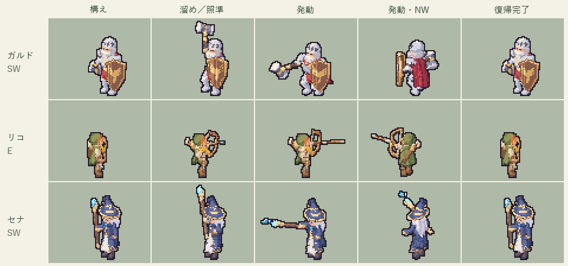

# 冒険者の一行　8方向の攻撃

[隊列プレビュー](../../docs/party.html)で「攻撃を1回再生」を押すと、同じ床面で3人のテンポを比較できる。「攻撃を繰り返す」は表示中の全員が復帰してから次の攻撃を開始する。「攻撃コマ」を動かすと一時停止し、同じ局面のまま方向を変えられる。各人物は[通常ギャラリー](../../docs/index.html)の選択欄にもある。

| キャラクター | クリップ | セル／足元アンカー | 総時間 | 発動（開始から） | 公開アセット |
| --- | --- | --- | ---: | --- | --- |
| ガルド | [重打撃](../../characters/gard/hammer-strike.json) | 100×100／(50, 75) | 960 ms | 540 ms・打撃 | [PNG](../../docs/assets/gard/attack.png) · [GIF](../../docs/assets/gard/attack.gif) · [JSON](../../docs/assets/gard/attack.json) |
| リコ | [射撃](../../characters/rico/bow-shot.json) | 80×80／(40, 65) | 590 ms | 360 ms・離弦 | [PNG](../../docs/assets/rico/attack.png) · [GIF](../../docs/assets/rico/attack.gif) · [JSON](../../docs/assets/rico/attack.json) |
| セナ | [氷魔法](../../characters/sena/frost-cast.json) | 100×100／(50, 75) | 1,000 ms | 580 ms・放出 | [PNG](../../docs/assets/sena/attack.png) · [GIF](../../docs/assets/sena/attack.gif) · [JSON](../../docs/assets/sena/attack.json) |

## ポーズと装備

ガルドの現行版はF6で前方へ打ち込み、F7でさらに押し込む。以下の初版から変更した軌道・方向別の観察と数値は[ガルドの重打撃の改訂記録](gard-hammer/README.md)に掲載した。

- **ガルド**　GOBLIN BRUTEの溜めと停止、MAREN・SKELETON GUARDの独立した盾腕を参考にした。左の盾を上げ、腰を引いて肩越しに槌頭を持ち上げる。4コマ目を190 ms保ち、5コマ目の50 msで腰を返す。打ち込んだ後の2コマは踏み出した足を同じ位置に置き、マントと肩が落ち着いてから槌を戻す。
- **リコ**　AZURE RONINの短い発動と左右の腕に別々の役割を持たせる構成を参考にした。左手は弓を前へ、右手は矢筈を持って後方へ動く。5コマ目の照準から6コマ目の離弦へ40 msの発射像を挟み、右手が後ろへ抜ける。弓を下ろす間、矢筒と腰の鉤は身体に付いたまま。
- **セナ**　CRYSTAL MAGEの詠唱、杖先の発光、髪と衣装の遅れを参考にした。両足を据え、左手を胸の方へ引き寄せて杖を起こす。4コマ目で水晶を明るくし、6コマ目で右腕を伸ばす。杖先から少数の青白い氷片が放射状に出る。7コマ目で発光を弱め、髪とローブを静止姿勢へ戻す。

## データを再生する

PNGは各行が S / SW / W / NW / N / NE / E / SE、各列が時間順の9コマ。ゲームでは `animations.attack` の `cell`、`anchor`、`durations_ms`、`loop: false` を読む。1列目と9列目は静止画像を攻撃セルの中央に置いたもの。描画先の床座標から各モードのアンカーを引く。隊列プレビューでは歩行中に攻撃を指示すると、次の片足支持の通過姿勢まで進む。床面移動を有効にした場合は最後の移動量を短くし、支持足のつま先を同じ床座標に残して構えに移る。単発の終了後は待機の先頭へ戻る。

`events[].frame` は0始まり。3人とも発動は列6（`frame = 5`）。経過時間が `time_ms` をまたいだときに1回通知できる。`position_model_xyz` は足元原点からの発動位置で、Xが本人の左、Yが前、Zが上。`direction_model_xyz` は正面モデルでの単位方向、`direction_by_row[向き]` は選択方向に回した単位方向（地面はXY、Sは+Y）。斜め視点の画面に出す際は位置も同じ向きに回し、カメラの仰角24°で投影する。

- `hammer_impact` は槌頭中心と、直前の姿勢からその中心が進んだ向き。
- `arrow_release` は表示中の矢先と矢軸の向き。`baked_projectile_frames: 1` のため、6コマ目の40 msはシートに飛翔像が1本ある。ゲームで矢を継続表示する場合は7コマ目の境界で表示を引き継ぐ。速度と飛距離はゲーム側で決める。
- `ice_release` は水晶先端と杖の向き。シートの氷片は6コマ目の短い発光表現。飛翔する氷弾や命中時の凍結はゲーム側で追加できる。

## 共通実装

装備の親は従来の `rig.attachments`、主手は `attack.tuning.main_hand_side` で指定する。リコは `hand_L`、他の2人は `hand_R`。検証器の静止補間キー、主手・反対の手のIK目標、握りの交差検査もこの指定を使う。

`attack.bow` は装備部位、弦の材質、両端のモデル座標、矢の寸法・材質を持つ。攻撃中は弦を外した作業用格子をポーズし、変換後の両端と矢筈を結ぶ。引き絞り中の矢筈は反対の手の関節へ固定する。離弦時に弦を元の弦長に戻し、直前の矢軸を使って単独の矢を前に出す。矢と氷片は攻撃専用の部位IDで、作業用アトラスとの対応は `transient_parts` に記録する。どちらも立体格子に描くため、手前の身体による遮蔽は8方向で働く。[弦と矢](../../spritestack/bow.py) · [氷片](../../spritestack/effects.py) · [攻撃検証器](../verify_attack.py)

広い軌道には `attack.cell` と `attack.posed_volume` を使う。初稿では全モードの格子原点を動かし、同じ関節姿勢でも歩行PNGの一部が変わった。攻撃だけ別の格子を選ぶ方式に変更した。3人の元モデル・待機・歩行クリップは従来のものを使う。

## 8方向の見え方

この比較図と以下の初回検証値は3人の攻撃を揃えた時点（`4f77259`）の記録。現行ガルドの比較は[原寸GIF](gard-hammer/comparison.gif)と[改訂後の検証結果](gard-hammer/README.md)を参照。

公開PNGから同じ2倍の最近傍拡大で切り出した。ガルドとセナはSW、リコは弦を引く両腕が分かれるE。4列目は全員NW。各行の足元は同じ高さに置いた。

隊列ページを1×・通常速度にし、8方向すべてで攻撃を繰り返した。9コマのPNGと原寸GIFでも準備・発動・復帰を追い、隊列では6コマ目で止めて向きを切り替えた。単発、反復、停止・再開、コマ指定、単独／3人の切替を操作した。床面移動を有効にした歩行からも攻撃に入り、各人物が自分の再生時間に従って待機へ戻った。通常ギャラリーでも3人それぞれを原寸で単発再生し、4コマの待機への復帰を確認した。

- **ガルド**　SWでは高く止めた槌頭から低い打点への落差が大きく見え、N・NEでは赤いマントの外を右腕が通る。NWは盾と肩甲が重なる。初稿は6・7コマ目の槌頭が完全に隠れた。手首と槌の軌道を右外側へ移し、原寸で肩甲の脇に槌頭の金属面が出る位置にした。NWの可視画素は6コマ目が82 px、7コマ目が81 px。腰・踏み込み・短い衝撃停止が重さを伝える。
- **リコ**　E・Wは、左右の手が開く照準と弓から離れて飛ぶ1本の矢を最も追いやすい。NW・NEではフードと矢筒が手前に来る。初稿では右手と弦が格子上で接触せず、Nの照準で矢が隠れた。弦の中央を右手に固定し、弓を持つ手の位置と矢の長さを調整した。Nの照準は4 px、離弦は8 px。S・Nは飛翔方向が視線に近く、原寸で矢軸が短く見える。
- **セナ**　溜めでは水晶が高く明るくなり、発動では杖を伸ばして氷片が水晶から離れる。SW・NEでは杖の傾きが大きく読める。Nでも氷片が帽子の外に出る。初稿で準備中の杖の下端がローブと重なったため、杖を持つ手を外へ移した。銀髪と裾は復帰の間だけ小さく揺れる。

## 技術検証と回帰

静止専用ベイクに `research.verify_character`、全モードのベイクに `research.verify_walk`、`research.verify_loops`、`research.verify_attack` を実行した。攻撃の始端・終端は8方向すべてで、足元を合わせた静止PNGとデコード後のRGBAが一致した。1クリップにつき97姿勢で主手・反対の手・足首のIKと武器先端材質の経路を調べた。両手の目標誤差は 10⁻⁶ モデル単位未満。9つの出力姿勢では握りと装備の接触、支持靴底の高さ、接地中のつま先、布と武器の干渉、素材の余白を検査した。

| キャラクター | 静止 PASS | 歩行 PASS | 攻撃中の握りの最小接触面数 | セル端までの最小余白 |
| --- | ---: | ---: | --- | ---: |
| ガルド | 33 | 16 | 右手・槌22、左手・盾11 | 2 px |
| リコ | 31 | 16 | 左手・弓18。引き絞り中は右手と弦の接触も全コマで確認 | 5 px |
| セナ | 30 | 16 | 右手・杖14 | 3 px |

3人の静止・歩行の検証はWARNING・FAIL・SKIPともに0。攻撃の全検査も通過した。 歩行からの切替では両側の支持足について8方向に回転してつま先を照合し、3体とも攻撃開始時のワールド座標との差は0だった。

発動コマの可視画素を下表に示す。完成画像上で手前の部位に隠れた画素を除いて数えた。槌頭・盾・弓・水晶は指定部位の材質、矢・氷片はそれぞれの一時部位IDを使った。

| 方向 | ガルド　槌頭／盾 | リコ　弓／飛翔中の矢 | セナ　水晶／氷片 |
| --- | ---: | ---: | ---: |
| S | 91 / 296 | 77 / 20 | 15 / 10 |
| SW | 98 / 359 | 85 / 28 | 19 / 19 |
| W | 65 / 244 | 80 / 36 | 15 / 14 |
| NW | 82 / 157 | 101 / 35 | 13 / 14 |
| N | 93 / 204 | 61 / 8 | 12 / 12 |
| NE | 103 / 71 | 28 / 31 | 19 / 16 |
| E | 105 / 89 | 64 / 33 | 22 / 15 |
| SE | 91 / 163 | 96 / 34 | 19 / 13 |

- **既存の冒険者3体**　作業開始時の公開素材（`1e291b0`）と再生成結果を比較した。静止・待機・歩行PNGのRGBA、待機・歩行GIFの全画素とコマ時間、静止・待機・歩行JSONの内容が一致した。共通の格子を広げた初稿で生じた歩行画素の差は、攻撃だけに格子を割り当てた後、全方向でゼロになった。
- **正式3体**　MAREN、CRYSTAL MAGE、AZURE RONINの静止・歩行・攻撃を再生成し、公開PNG・メタデータと照合した。FAIL・SKIPは0。既存のWARNINGは、MARENの部位内の孤立片1件、CRYSTAL MAGEの孤立片4件と歩行SW・SEでの眼の画素数変化。各孤立片は他部位のボクセルによって分かれており、公開済み画像と一致する。AZURE RONINはWARNINGも0。
- **研究用2体**　LARKの旧基準とBRAMの保存済み基準に対し、静止・歩行・攻撃の再生成RGBAとメタデータが一致した。BRAMは専用検証で128枚のRGBA、装備固定、靴底、歩行接地と攻撃リターゲットも通過した。[研究用の回帰手順](../../docs/TECHNICAL_DESIGN.md#研究用の回帰)
- **再現性**　3人とも全モードの一括ベイクと、別の出力先への攻撃単独ベイクを実行した。各回のPNGのRGBAハッシュ、攻撃JSON、公開GIFの全コマの画素と表示時間が一致した。

## 残っている制約

S・Nの射撃は奥行き方向に縮むため、最も小さく見えるNでは射撃の判別に腕と弓の動きも使う。背面の盾や杖の柄には、立体の前後関係による部分的な遮蔽がある。床面移動と接地の確認範囲は水平な床・クリップ規定速度。実ゲームでの入力応答、当たり判定と打点の同期、飛翔中の弾への引き継ぎ、ヒット時の手応えは未検証。

## 再生成と照合

PowerShellでリポジトリのルートから実行する。8方向のGIFはすべての方向を横に並べた原寸の確認用ループ。ゲーム用のJSONは単発再生を指定する。

~~~powershell
$py = (Resolve-Path .\.venv\Scripts\python.exe).Path
$run = Join-Path $PWD ('.phase1/party-attack-' + [guid]::NewGuid())
foreach ($id in 'gard','rico','sena') {
    $cfg = "characters/$id/character.json"
    $static = "$run/$id-static"
    $all = "$run/$id-all"
    $assets = "$run/$id-assets"
    & $py -m spritestack --character $cfg --modes idle --out $static
    & $py -m spritestack --character $cfg --out $all
    & $py -m research.verify_character --character $cfg --out $static
    & $py -m research.verify_walk --character $cfg --out $all
    & $py -m research.export_loops --neutral $static --animated $all --out $assets
    & $py -m research.verify_loops --character $cfg --out $all --published "docs/assets/$id"
    & $py -m research.verify_attack --character $cfg --out $all --published "docs/assets/$id"
    & $py -m spritestack --character $cfg --modes attack --out "$run/$id-attack"
    & $py -m research.verify_attack --character $cfg --out "$run/$id-attack" --published $assets
}
~~~

`docs/party.html` は直接開いても再生できる。通常ギャラリーは `& $py -m http.server 8000 --bind 127.0.0.1 --directory docs` を起動して [index.html](http://127.0.0.1:8000/index.html) を開く。
