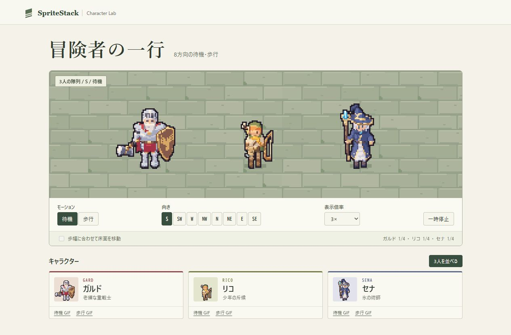
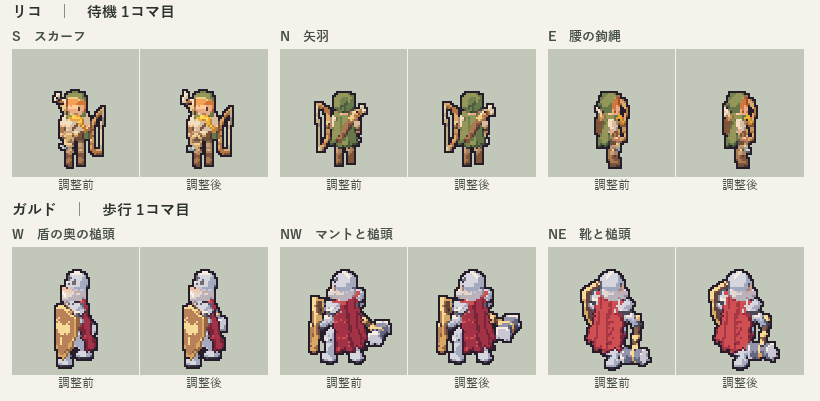
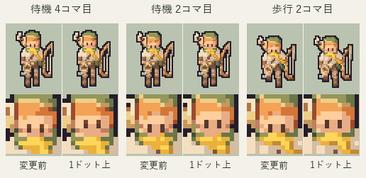
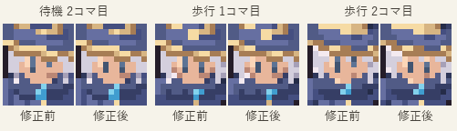

# 冒険者の一行

ガルドの白髭と盾、リコのフードと左手の弓、セナの折れた尖り帽子と水晶杖を、同じ24°の正投影で描いた。各人物に一つの材質格子と部位格子があり、全方向・全コマがその立体を共有する。[隊列プレビュー](../../docs/party.html)

4人目のトビは紫のバンダナと真鍮ゴーグルを着け、右手に黒い発破玉を持つ。[トビの制作・検証記録](tobi/README.md)



## ゲームで使う

| 名称 | 立体・リグ・材質・品質条件 | 待機シート | 歩行シート | コマ送り | 1コマの前進量 |
| --- | --- | --- | --- | --- | ---: |
| ガルド | [gard](../../characters/gard/) | [PNG](../../docs/assets/gard/breathe.png) | [PNG](../../docs/assets/gard/walk.png) | 3 / 7 fps | 2.052 |
| リコ | [rico](../../characters/rico/) | [PNG](../../docs/assets/rico/breathe.png) | [PNG](../../docs/assets/rico/walk.png) | 3 / 11 fps | 1.406 |
| セナ | [sena](../../characters/sena/) | [PNG](../../docs/assets/sena/breathe.png) | [PNG](../../docs/assets/sena/walk.png) | 3 / 8 fps | 1.748 |
| トビ | [tobi](../../characters/tobi/) | [PNG](../../docs/assets/tobi/breathe.png) | [PNG](../../docs/assets/tobi/walk.png) | 3 / 9 fps | 1.824 |

前進量の単位はモデル座標。コマ送りは待機／歩行の順。描画密度は全員1.50 px/単位。各セルは64×64の透過RGBAで、左上から (32, 57) が床面上の同一アンカー。

| ファイル | 配置と読み方 |
| --- | --- |
| `breathe.png` と `breathe.json` | 256×512。方向が行、時刻が列。4コマをループ。先頭が静止姿勢と画素単位で一致 |
| `walk.png` と `walk.json` | 384×512。同じ行順で6コマをループ。`contact` は0始まりの支持区間を含む |
| `idle.png` と `metadata.json` | 512×64。造形確認・初期表示用の静止8方向。こちらは方向が列 |
| `breathe.gif` と `walk.gif` | 8方向を横に並べた原寸ループ。GIFの時間は各コマ境界を10 ms単位へ丸めている |
| `attack.png`、`attack.gif`、`attack.json` | 人物ごとの9コマ単発攻撃。JSONにコマ時間、発動時刻、発動位置、8方向の発動ベクトルを収録 |
| `preview.js` | 同梱プレビュー用の再生設定。メタデータと関節座標からコマ時間と歩行停止時の支持足・移動量を生成 |

方向順は **S / SW / W / NW / N / NE / E / SE**。モーションJSONの `animations[モード名]` から `rows`、`columns`、`cell`、`anchor`、`fps` を読む。描画先はワールド座標を投影した点からアンカーを引いた位置。歩くときはコマの進みとともに `suggested_forward_per_frame_model_units` だけルートを前進させる。停止は両足が着く0または3コマ目に合わせると、片足を上げたまま静止へ戻る段差を避けられる。

## プレビュー

攻撃は隊列・単独の両方で再生できる。「攻撃を1回再生」で待機へ戻り、「攻撃を繰り返す」で連続比較する。「攻撃コマ」を動かすと同じ番号の姿勢で止まり、方向だけを切り替えられる。攻撃のセル、発動イベントと再生成コマンドは[攻撃制作・検証記録](ATTACKS.md)にまとめた。

各人物のカードで単独表示、「3人を並べる」で隊列へ戻る。1×がゲーム原寸。歩行中に「歩幅に合わせて床面を移動」を選ぶと先頭の人物をカメラが追い、ほかの人物も自分の歩幅とテンポで進む。床模様と支持足の関係を見たいときに使う。

PowerShellでリポジトリのルートから起動し、[ローカルのプレビュー](http://127.0.0.1:8000/party.html) を開く。

```powershell
.\.venv\Scripts\python.exe -m http.server 8000 --bind 127.0.0.1 --directory docs
```

## 原画から立体にした箇所

- **ガルド**　MARENの左右の手装備とFLEUR KNIGHTの板金構造を参考に、幅のある胸甲、上下に重なる大腿甲、開いた兜と前に張り出す白髭を作った。盾の紋章は翼と尾を持つ金の鳥に簡略化。盾の裏面は革と推定した。ハンマーを低く浮かせ、右後方へ流すことで、盾と重なる真横でも頭部が残る。
- **リコ**　AZURE RONINのスカーフ追従を参考に、短い脚、大きめのフード、銅色の前髪、革の短パンを設計した。原画の弓は本人の左手。木枠・弦・握りを一体化し、右手を空けた。背面は右肩の後ろへ矢羽が出る斜めの矢筒、右腰は輪にした縄と二股の鉤とした。
- **セナ**　CRYSTAL MAGEの杖と裾の追従を参考に、金縁の折れ帽、銀髪の房、前を開いた重ね着を作った。杖は指定どおり右手。水晶の青い面を白い反射より広く取り、斜め後ろでも金の爪と区別できるようにした。後ろ裾を少し高く仕立て、後方視点で支持足が見える長さにした。

各キャラクターの `reference_regions.json` に1500×1125原画での採色矩形とランドマーク、`reference_palette.json` に取得画素数・代表色・元画像SHA-256、`palette_provenance.json` に材質と採色領域の対応を保存した。最終3階調は、銀髭と板金、黄布と生成り、氷と金縁の色面が分かれるよう調整した。人物ごとの面積比は矩形内の概算で、隣人の装備が重なる領域もある。元画像は配布物に含めていない。

## 再生成

[リポジトリのPython環境](../../README.md#windowsのpython環境) を用いる。以下は新しい作業先へ3体をベイクし、同梱済みのモデル・素材と照合する手順。モデルの再生成そのものは静止検証器がメモリ上でも照合する。

```powershell
$py = (Resolve-Path .\.venv\Scripts\python.exe).Path
$run = Join-Path $PWD ('.phase1/party-' + [guid]::NewGuid())
foreach ($id in 'gard','rico','sena') {
    $char = "characters/$id"
    $cfg = "$char/character.json"
    & $py -W error::RuntimeWarning -m "characters.$id.build_model" --out "$run/$id-model"
    & $py -m spritestack --character $cfg --modes idle --out "$run/$id-neutral"
    & $py -m research.verify_character --character $cfg --out "$run/$id-neutral"
    & $py -m spritestack --character $cfg --out "$run/$id-all"
    & $py -m research.verify_walk --character $cfg --out "$run/$id-all"
    & $py -m research.export_loops --neutral "$run/$id-neutral" --animated "$run/$id-all" --out "$run/$id-assets"
    & $py -m research.verify_loops --character $cfg --out "$run/$id-all" --published "docs/assets/$id"
    & $py -m research.verify_attack --character $cfg --out "$run/$id-all" --published "docs/assets/$id"
}
```

造形を更新する際は、モデル生成後に `$run/$id-model` の `materials.npz` と `part_ids.npz` を対象の `characters/$id/` へ反映してからベイクする。確認後、`$run/$id-assets` の全ファイルを対応する `docs/assets/$id/` へコピーする。作業ベイクには各ポーズの `joints.json`、再スライスした立体、可視部位IDアトラス、装備の床面距離と可視画素測定も出力される。共通モーションは [呼吸](../../motions/breathe.json) と [歩行](../../motions/walk.json)。

原画から代表色を再取得する場合は、ローカルにある同じ画像を指定する。モデル・スプライトの再生成には画像ファイルは不要。

```powershell
$id = 'gard'
& $py -m characters.maren.extract_reference --image $reference --regions "characters/$id/reference_regions.json" --out "$run/$id-palette.json"
```

## 技術検証

新しい作業先からの再ベイクで静止・待機・歩行のデコード後RGBAと公開メタデータが一致した。GIFは全コマを元シートと照合し、ループの時間も確認した。静止検証のPASSはガルド32、リコ30、セナ29。歩行は各16。3体ともWARNING・FAIL・SKIPは0だった。

| 実測値 | ガルド | リコ | セナ |
| --- | --- | --- | --- |
| 歩行48コマでの装備の最小可視画素 | ハンマー28、盾62 | 弓23、矢羽3 | 杖全体13、水晶8 |
| 待機32コマでの最小可視画素 | ハンマー45、盾71 | 弓34、矢羽2 | 杖全体9、水晶7 |
| 歩行中の装備の最低高さ（モデル単位） | ハンマー2.0、盾4.5 | 弓2.5 | 杖2.5 |
| 待機／歩行の最小透明余白 | 3 / 2 px | 4 / 3 px | 2 / 2 px |

全員の支持足マーカーは規定前進量を相殺して静止し、ブーツは支持区間だけ床面に接する。描画した靴底と床面投影の差は全方向で最大1 px。待機では両ブーツの立体が全コマで静止姿勢に一致する。手と装備は全コマで接触し、歩行時の目の材質は各方向で可視画素数を維持する。

共通処理には任意の呼吸クリップ、攻撃クリップの省略、体格別の歩行fpsを追加した。正式3体は静止・歩行・攻撃を再生成し、公開RGBAとJSONが一致。LARKとBRAMも保存基準と一致した。既存サンプルの警告はMARENとCRYSTAL MAGEの静止部位断片、およびCRYSTAL MAGEのSW・SE歩行での目の画素数変動で、既知の結果を再現した。

## 見た目の確認と制約

ブラウザの同じ石畳に3人を並べ、1×・通常速度で全8方向を再生した。各方向で3人それぞれの待機4コマ、歩行6コマが一巡することを表示コマからも確認した。単独表示、停止と再開、待機と歩行の往復、表示倍率と床面移動を操作した。

- **ガルド**　Sでは白髭、銀の肩甲、左右の装備が分かれる。Wでは盾が前、ハンマーが奥に回る。初版の歩行4コマ目ではハンマーが完全に隠れたため、頭部の位置を右後方へ移した。最終版はWでも輪郭が残り、Nでは深紅の背面と交互に出る靴底が見える。
- **リコ**　S・SEでは黄布と短いズボン、NW・Nではフードから外に出た矢羽と斜めの矢筒が目印になる。左手の弓は横向きに細くなる。鉤は右腰に固定され、NWでは身体に隠れる。Wでは端が最大2画素だけのぞく。S・NE・E・SEでは待機・歩行のどのコマにも金属部分が4画素以上見える。
- **セナ**　S・SEでは淡色の前身頃が開き、N・NEでは濃い背面に銀髪が重なる。W・NWの待機で上端に触れた杖は、画素密度と杖冠の高さを調整した。歩行の片脚支持でも裾から靴が見え、水晶の位置は握りと一緒に移る。

原寸では盾の羽根、ロープの撚り、ローブの刺繍を色のまとまりに簡略化した。6コマの歩行は一定速度の平地ループ。方向転換の補間、段差・坂道への接地、実ゲーム側の当たり判定は検証範囲外。

### リコとガルドの調整前後



- **リコ**　黄布を少し明るい黄に寄せ、首の前の巻きと垂れ端をわずかに太くした。S待機で見える黄布は29〜33画素から33〜36画素になった。フードの大きさを保ちながら、既存の3本の矢羽に長さと高低差をつけた。N歩行で見える羽色の最小面積は9画素から14画素に増えた。右腰では巻き縄の下から鉤を吊り、二股の先に奥行きをつけた。
- **ガルド**　右手の握りを支点に柄を少し起こし、槌頭の両端と断面を広げた。W歩行1コマ目では盾の奥に見える槌頭の金属面が幅2画素から5画素、面積10画素から26画素になった。NW・NEの歩行では全コマで金属面がそれぞれ94画素以上・98画素以上見える。途中案で槌頭が支持足を隠したNE歩行5コマ目も、採用版では靴底が床面投影と同じ行に現れる。

調整前の基準は `cd17d12`。画素数は画面上で見える対象部位の材質を数えた値。槌頭の金属面には鉄と明色の鋼を含む。8方向をブラウザで1×・通常速度で比較し、上図は同じコマを最近傍で2倍に拡大した。

### リコの正面の目



修正前（`bf8134e`）の待機4コマ目は、瞳の2画素が画面右側に縦に並んでいた。待機2コマ目は左右に1画素ずつ出たが、高さが1画素ずれていた。顔に埋まった小さな瞳を斜め上から投影すると、顔の上下動によって拾われる側と高さが変わっていた。口を描いた薄い茶色の面もコマによって現れたり消えたりしていた。

`d270ab9` で瞳を顔の表面に置き直し、口元を肌色の陰影にまとめた。その後、左右の瞳を縦2ドットにした。上図ではその版を基準に、瞳と周囲の肌の立体を調整し、正面で両目が1ドット高く見えるようにした。

正面の静止姿勢、待機4コマ、歩行6コマの各画像で、瞳の色は x=30 と x=33 の列に縦2画素ずつ現れる（64×64セルの左端が0）。両目の上端と下端がそろい、間には肌色が2画素残る。待機・歩行の品質検査では、左右それぞれの瞳の材質が正面の各コマで最低2画素見えることを確認する。

### セナの正面の目



修正前の待機2コマ目では、画面左の瞳が縦3画素、右が1画素だった。斜めの前髪の下で瞳が左右とも見えるよう、頭部モデルの瞳と周囲の肌の奥行きを調整した。正面の静止姿勢、待機4コマ、歩行6コマのPNGを調べ、すべてで x=30 と x=33 の列に瞳が縦2画素ずつ並ぶことを確認した。両目の上端の行は待機で 25・24・23・24、歩行で 26・27・26・26・27・26（セル上端が0）。隊列プレビューの原寸で正面の待機・歩行を再生し、8方向のGIFも確認した。
