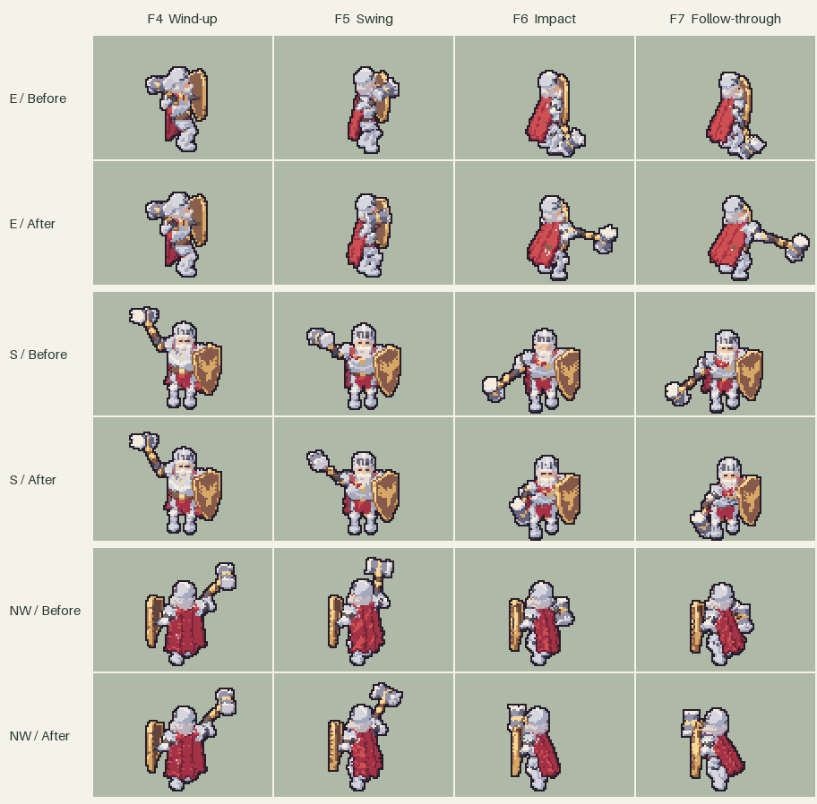
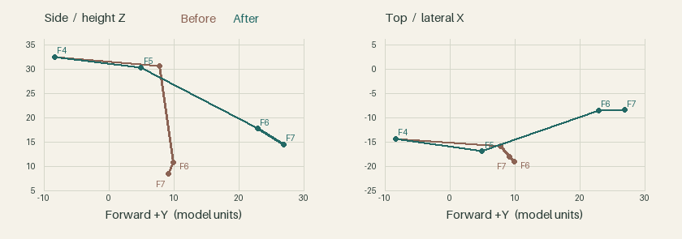

# ガルドの重打撃を前へ押し込む

F4の振りかぶりから腰を返し、F6で前方へ打ち込み、F7で右肘を伸ばしてさらに押し込む9コマの単発攻撃。左右から見ると、F6の槌頭は胸より約28 px前にあり、F7でさらに約6 px進む。9コマの表示時間、全長960 ms、発動時刻540 msを引き継いだ。[隊列プレビュー](../../../docs/party.html) · [攻撃PNG](../../../docs/assets/gard/attack.png) · [攻撃GIF](../../../docs/assets/gard/attack.gif) · [イベントJSON](../../../docs/assets/gard/attack.json)

[8方向の変更前後を同期再生するGIF](comparison.gif)は上段が変更前、下段が変更後。足元を合わせ、原寸・等速で同時に再生する。変更前の公開GIFは `4f77259` のファイルをそのまま[基準GIF](before.gif)として保存した。

## モデル空間での軌跡

計測点はゲームイベントと同じ `hammer_head`（槌頭中心）。単位はモデル単位で、+Yが前、+Zが上、+Xが本人の左。下図は同じ4点を側面と上面に投影したもの。全9コマの時刻と槌頭・右手・肘・肩・腰・両つま先のXYZは[座標CSV](trajectory.csv)に記録した。

| 測定 | 変更前 | 変更後 |
| --- | ---: | ---: |
| F5→F6の槌頭の前進量 | +2.225 | **+17.928** |
| F5→F6の槌頭の高さ変化 | −19.848 | −12.657 |
| F6→F7の槌頭の前進量 | −0.786 | **+3.982** |
| F5→F7の槌頭の前進量 | +1.439 | **+21.910** |
| F6の槌頭が右手より前に出る距離 | 4.183 | 10.346 |
| F7の槌頭が右手より前に出る距離 | 3.097 | 10.128 |
| F7の槌頭が胸より前に出る距離 | 6.524 | 21.773 |

F4の槌頭は両版とも (−14.336, −8.331, 32.466)。F5では腰が前方に移り、胴の向きがF4の+27°から−4°に回る。F6の胴は−30°、前傾22°、F7では−37°、前傾26°。F6→F7で右肩が1.78、右手が4.20前進し、右肘の内角は79°から143°へ開く。F6で踏み込み足が着いたあとも腰は1.00前進する。F8では右肘を畳み、槌を身体の外側へ引きながら上体を起こす。F9は元の構えに一致する。[攻撃クリップ](../../../characters/gard/hammer-strike.json)

`hammer_impact` はF6の開始時（0始まりの `frame = 5`）。新しいイベント位置は **(−8.501, 22.896, 17.671)**。F5からの実測変位を正規化した方向は (−0.155, +0.110, −0.982) から **(+0.358, +0.763, −0.538)** に変わった。8方向の変換済みベクトルはJSONの `direction_by_row` に収録した。

## 原寸での観察

隊列ページでガルドを単独表示し、1×・通常速度で8方向を再生した。F6とF7をコマ送りでも比較した。下表の数値は、手前の部位に隠れた部分を除く槌頭の金属材質の画素数。

| 向き | F6 | F7 | 観察 |
| --- | ---: | ---: | --- |
| S | 99 | 96 | 画面左上から手前へ打ち込む。F7では右膝の手前まで槌頭が下がる。奥行き方向のため柄は短く見える。 |
| SW | 99 | 92 | 盾の外へ斜めに振り下ろし、腕と柄が続く。 |
| W | 101 | 102 | 槌頭が盾の前縁を越える。支持足を固定したまま次のコマでさらに左へ出る。 |
| NW | 75 | 73 | 振りかぶりから盾の前側へ抜ける。打点で柄の一部が盾と重なり、金属の槌頭が上縁に見える。 |
| N | 67 | 72 | 兜の脇に槌頭が残り、前傾とマントの動きで振り切りを追える。 |
| NE | 95 | 87 | 赤いマントの外に腕と槌頭が出る。 |
| E | 105 | 98 | 右手と柄が横に伸び、F6からF7の押し込みが最も追いやすい。 |
| SE | 99 | 99 | 槌頭が盾の手前を通り、F7で低い打点に達する。 |

試作ではNWのF8で槌頭の可視画素がゼロになった。復帰時に手首を外へ引き、槌頭を少し上げたことで同じコマに87 px残る。全72画像で槌頭・盾ともに可視。隊列の単発再生でF9から4コマ待機へ戻り、通常ギャラリーでも全8方向で待機復帰を確認した。実ゲームでの命中判定と入力応答は未検証。

## 技術検証と回帰

- `research.verify_attack` が全モード生成・攻撃単独生成の両方で通過。97姿勢で左右の手首・足首のIKと槌頭の経路を確認した。9コマの最小接触面数は右手と槌が22、左手と盾が11。F6・F7の踏み込み足のつま先は (−3.44, 6.42, 0)、支持足は (2.74, 1.43, 0)。両方の座標がこの区間で一致した。
- 試作前後とも97姿勢で、槌全体の元ボクセル中心を盾・頭・胴・腰・反対の前腕／手・両大腿・両ブーツの部位格子と照合し、内部への入り込みは0。動くマントと槌の干渉検査も通過した。
- ガルドの攻撃セルは **100×100、アンカー (50, 75)**。F7の前方到達に合わせて攻撃作業格子の+Y上限を32から38へ広げた。最小透明余白はW・Eの3 px。従来の84×84セルと足元をそろえて比較すると、F1〜F4・F9のRGBAは全方向で完全一致した。
- ガルドの静止検証は33件、歩行は16件PASS。待機・歩行の検査も通過し、再生成した静止・待機・歩行の公開PNG・GIF・JSONは元ファイルとバイト単位で一致した。全モードと別出力先での単独攻撃ベイクについて、公開PNGのRGBA、GIF全コマと時間、JSONの内容を照合した。
- リコ・セナは静止・待機・歩行・攻撃を再生成して公開素材と照合した。正式3体とFLEUR KNIGHT・CRIMSON BLADE・GOBLIN BRUTE・SKELETON GUARDも静止・歩行・攻撃の公開回帰を通過し、LARK・BRAMは保存済みの基準に一致した。FAIL・SKIPは0。従来からのWARNINGはMARENの部位の分離片1件、CRYSTAL MAGEの分離片4件と歩行SW・SEでの目の画素数変化。共通エンジンとリグの変更はない。

## 再生成

リポジトリのルートから実行する。比較用スクリプトはベイク済みのPNG・関節・メタデータを読み、同じ倍率・足元・時刻の図とCSVを出力する。

~~~powershell
$py = (Resolve-Path .\.venv\Scripts\python.exe).Path
$run = Join-Path $PWD ('.phase1/gard-strike-' + [guid]::NewGuid())
New-Item -ItemType Directory -Path $run | Out-Null
git archive --format=zip --output "$run/basis.zip" 4f77259 characters/gard motions
Expand-Archive -LiteralPath "$run/basis.zip" -DestinationPath "$run/basis"
& $py -m spritestack --character "$run/basis/characters/gard/character.json" --modes attack --out "$run/before"
$cfg = 'characters/gard/character.json'
& $py -m spritestack --character $cfg --modes idle --out "$run/static"
& $py -m spritestack --character $cfg --out "$run/after"
& $py -m research.verify_character --character $cfg --out "$run/static"
& $py -m research.verify_walk --character $cfg --out "$run/after"
& $py -m research.verify_loops --character $cfg --out "$run/after" --published docs/assets/gard
& $py -m research.export_loops --neutral "$run/static" --animated "$run/after" --out "$run/assets"
& $py -m research.verify_attack --character $cfg --out "$run/after" --published docs/assets/gard
& $py research/adventurers/gard-hammer/compare.py "$run/before" "$run/after" "$run/comparison"
~~~
