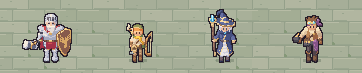
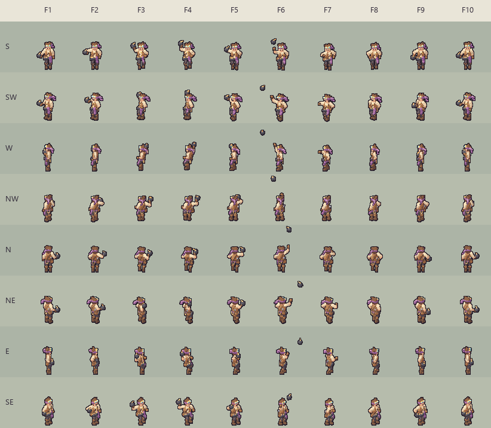

# TOBI — 発破師トビ

トビの投擲は、同じ発破玉を右手で持ち、離手の瞬間だけ独立した位置に描き、空の手を腰袋へ戻す10コマの単発モーション。隊列では「トビ」または「4人を並べる」を選び、「攻撃コマ」で同じ局面を8方向から確認できる。[隊列プレビュー](../../../docs/party.html) · [原寸の投擲GIF](../../../docs/assets/tobi/attack.gif) · [再生・イベントJSON](../../../docs/assets/tobi/attack.json)

## 原画から立体へ



添付の691×929画像で、頭頂・顎・肩・腰・膝・足底を記録し、髪、紫布、ゴーグルの縁とレンズを含む11材質を採色した。見分ける順序は、額を一周する紫と水色のレンズ、右手の大玉と腰に並ぶ小玉、生成りの袖に挟まれた革ベストと紫の腰布。原画の頭上にあった右手を腰の外へ下げ、画面上で予備玉と重ならないようにした。背面には結び目から伸びる長短2本の布、交差する革帯、縄の輪、短い石工用たがねを配置した。[採色矩形・ランドマーク](../../../characters/tobi/reference_regions.json) · [抽出値・原画ハッシュ](../../../characters/tobi/reference_palette.json) · [採用色の根拠](../../../characters/tobi/palette_provenance.json)

ガルドの肩幅とリコの素顔・作業革を体格と材質の比較に使い、セナの右手装備、リコの放出コマを持ち手とイベントの手本にした。静止時の頭部材質の上端はリコ25.0、トビ31.5、ガルド33.5モデル単位。3人と同じ24°、1.50 px/単位、足元 (32, 57) で描く。17材質・16部位を0.5単位の格子に割り当てた。[造形](../../../characters/tobi/build_model.py) · [関節と装備](../../../characters/tobi/character.json)

静止初稿では正面の予備玉が暗い帯状に見え、腰布も細かった。3個を高さの異なる留め具で下げ、玉の間に明るい革が見えるようにした。正面で見える予備玉の鉄は23→33 px、腰布の紫は36→48 px。右手を少し外へ出すと、NWで見える手持ちの鉄も1→6 pxに増えた。水色のレンズはSで12 px、SW・SEで各9 px。背面は紫の帯と結び目で追える。[静止8方向](../../../docs/assets/tobi/idle.png)

## 呼吸と歩行

待機は4コマ・3 fps。胸と肩を上下させ、バンダナの先と腰布の下端だけを遅らせた。歩行は共通の6コマを9 fps、床面での1コマの前進を1.824単位とした。利き手の振幅を抑え、空いた左腕を大きく振る。予備玉・袋・たがねは骨盤に固定し、縄は最大5°に抑えた。歩行初稿で前腕と玉が最大2ボクセル重なったため、歩行中の右手首を16°傾け、握りを保ったまま前腕から離した。[待機GIF](../../../docs/assets/tobi/breathe.gif) · [歩行GIF](../../../docs/assets/tobi/walk.gif)

初稿の正面では呼吸で各瞳が2–3 px、投擲で2–6 pxに変わった。瞳を頬の表面に沿う小さな楕円にし、歩行の頭の高さと攻撃時の首の横移動を調整した。最終版は正面の両目が全20コマで片目2 px。歩行では方向ごとにも全6コマで各瞳の画素数が一定になった。

## BOMB THROW

想定する相手はトビの正面。右足で地面を押し、左足を前へ運び、肩越しに玉を放る。溜めの胸のひねりは+32°、離手時は−22°、振り抜きでは−30°。骨盤は胸の52%だけ回す。F4からF6で右手はモデル前方へ13.12単位進む。F7ではさらに前へ、かつ低く振り抜く。F6–7は左つま先が同じ床座標に残る。[投擲キー](../../../characters/tobi/bomb-throw.json)

| コマ | 始点 | 表示時間 | 原寸で追う動き |
| --- | ---: | ---: | --- |
| F1 | 0 ms | 70 ms | 腰の外で右手に保持 |
| F2 | 70 ms | 95 ms | 玉を横へ引き、反対の腕が前へ |
| F3 | 165 ms | 105 ms | 玉が肩の後ろへ上がる |
| F4 | 270 ms | 145 ms | 左足を上げたまま振りかぶる |
| F5 | 415 ms | 55 ms | 腰を返し、左足が着地へ向かう |
| F6 | 470 ms | 60 ms | 左足を接地。右手から離れた1個を表示 |
| F7 | 530 ms | 125 ms | 空の右腕を低く前へ振り抜く |
| F8 | 655 ms | 100 ms | 右手を腰袋の口へ運ぶ |
| F9 | 755 ms | 95 ms | 次弾を袋から持ち上げる |
| F10 | 850 ms | 70 ms | 静止と同じ構え。920 msで完了 |



`bomb_release` は0始まりの `frame: 5`、470 msで1回発動する。モデル空間の射出位置は (−8.955, 8.211, 28.805)、単位方向は (0.016, 0.713, 0.701)。ベイクはF5→F6の玉中心の移動から向きを求める。F6の画像では、その位置から同じ方向へ18モデル単位先に玉を1個置く。ゲーム側は470 msでイベントを受け、表示は530 msから引き継げる。8方向のベクトルは `direction_by_row`、ベイク済みの飛翔像は `baked_projectile_frames: 1`。F7–8の格子には手持ち玉の部位がなく、F9で右手に戻る。腰前の3個は装飾として残り、次弾は右腰の袋から出す。[公開イベント](../../../docs/assets/tobi/attack.json)

## 原寸で見える動き

| 向き | F4 溜めの鉄 | F6 離手の鉄 | F6の玉と身体の画素中心間距離 | 原寸で読み取れる変化 |
| --- | ---: | ---: | ---: | --- |
| S | 36 px | 31 px | 5.8 px | 顔の外で上げた玉が手袋から浮く。空の手は胸の前を斜めに下がる |
| SW | 25 px | 32 px | 16.3 px | 肘を引く、左足を置く、右腕を伸ばす順を追える |
| W | 29 px | 31 px | 23.3 px | F5では袖が玉の一部を遮り14 px。F6では前へ離れた球形が現れる |
| NW | 33 px | 35 px | 24.2 px | 背中越しでも振りかぶった玉が肩の外へ出る。F9の次弾は袋の脇に3 px見える |
| N | 33 px | 35 px | 23.0 px | 玉が頭頂の右上へ抜ける。踏み込んだ左足と背中のねじれが残る |
| NE | 35 px | 36 px | 24.7 px | 右腕が手前を通り、後方の溜めと前方の離手の差が大きい |
| E | 33 px | 33 px | 23.7 px | 玉、手袋、袖を順に追え、F7の空振り抜きが読みやすい |
| SE | 38 px | 33 px | 5.4 px | 斜め前への軌道が短く投影される。離手した玉の輪郭と腕の間に背景が入る |

距離は輪郭線を付ける前の部位ID画像で測った最短のユークリッド距離。初稿のS・SEは1 pxで、立体上で離れていても輪郭がつながって見えた。F5の手の高さ・前後位置、離手位置と表示オフセットを一緒に見直し、全方向で離手が読めるようにした。上方へ抜ける玉を収めるため、攻撃だけ104×104、アンカー (52, 77) とした。最小余白はN・F6の上端1 px。

## 技術検証

保持中の装備は右手の取り付けマーカーを使う。分離時には再スライス前に装備の変換だけを変えるため、手・袖・身体が通常どおり描かれる。投擲イベントを持つクリップに適用し、検証器では離手姿勢の部位マスク全体と材質を独立して再構成し、二重表示・非表示・再装備時の握りを確認する。呼吸の布揺れは `breathe.secondary` に指定した領域へ適用した。[共通仕様](../../../docs/TECHNICAL_DESIGN.md) · [トビの検証条件](../../../characters/tobi/quality.json)

投擲の109補間姿勢で両手・両足のIKを確認した。保持コマで右手と玉は最低32ボクセル面で接触し、F6の玉は右手との接触がゼロ。F7・F8では手持ち玉の部位がゼロで、F9では再び右手に接続する。攻撃の始端・終端は8方向とも静止PNGとRGBAが一致する。水平な床での歩行→攻撃は、左右それぞれの支持足を8方向に回して引き継ぎ位置を照合した。

公開素材との照合を含む静止検証は32項目、歩行検証は16項目がPASSで、トビのWARNING・FAIL・SKIPはすべて0。歩行中の支持足のずれはモデル単位で最大 8.9×10⁻¹⁶、全48枚で紫のバンダナは最低24 px、手持ち玉の鉄は最低6 pxだった。玉と右手は全6コマで最低33ボクセル面が接触し、右手以外の部位との重複は0ボクセル。待機・歩行・攻撃のPNGとJSON、原寸GIFの全画素・時間を照合し、攻撃単独ベイクでも同じ公開素材と一致した。

## 回帰とブラウザ再生

公開ギャラリーにある既存10体の静止・歩行・攻撃を再生成し、公開PNGのRGBAと各JSONが一致した。呼吸を持つGARD・RICO・SENAは待機PNGと3種類のGIFの画素・時間も照合した。LARKは元パッケージ、BRAMは保存基準のPNG・メタデータと一致し、BRAMの128枚の検査にも合格した。既存のWARNINGはMARENの部位内の孤立片1件、CRYSTAL MAGEの孤立片4件とSW・SE歩行時の瞳の面積変化。いずれも公開済みの画像と一致し、既存体のFAIL・SKIPは0。

Chromeで隊列の4人表示・トビ単独表示と通常ギャラリーを1×・通常速度にし、各8方向の待機4・歩行6・攻撃10コマを確認した。GIFもブラウザに原寸表示し、全方向を並べた待機4枚・歩行6枚・攻撃9種類の表示画像が取得画面と一致した。攻撃のF1とF10は同一の構えで、10個の表示時間はGIFデコードで別途確認した。床面移動からの単発、10コマ目への移動、反復の解除、直接開いた隊列ページでの全員の選択も確認した。

確認範囲は水平な床と規定テンポでのキャラクター表示。飛翔の継続、着弾、爆発、地形・敵への効果は将来のゲーム側で扱う。

## 再現手順

PowerShellでリポジトリのルートから実行する。反復用に毎回新しい出力先を作る。

```powershell
$py = (Resolve-Path .venv/Scripts/python.exe).Path
$cfg = 'characters/tobi/character.json'
$run = Join-Path $PWD ('.phase1/tobi-' + [guid]::NewGuid())
& $py -W error::RuntimeWarning -m characters.tobi.build_model --out "$run/model"
& $py -m spritestack --character $cfg --modes idle --out "$run/static"
& $py -m spritestack --character $cfg --out "$run/all"
& $py -m research.export_loops --neutral "$run/static" --animated "$run/all" --out "$run/assets"
& $py -m research.verify_character --character $cfg --out "$run/static"
& $py -m research.verify_walk --character $cfg --out "$run/all"
& $py -m research.verify_loops --character $cfg --out "$run/all" --published docs/assets/tobi
& $py -m research.verify_attack --character $cfg --out "$run/all" --published docs/assets/tobi
```
