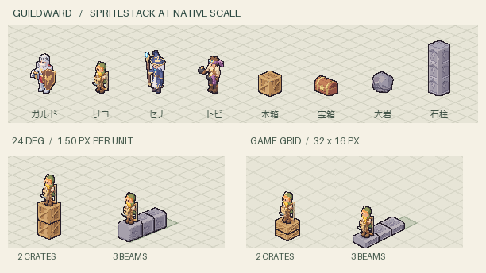
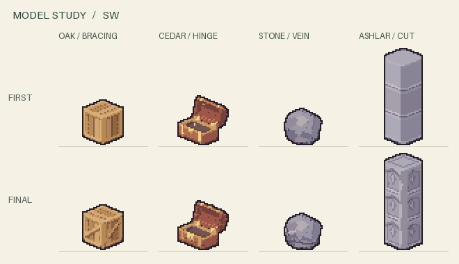

# オブジェクト制作実験01　GUILDWARD

木箱・宝箱・大岩・石柱の全10状態／動作を、各8方向、合計288セルで制作した。比較画面では既存のガルド・リコ・セナ・トビと同じ床に置き、支持面と動作を原寸で確認できる。台帳上はLabの公開素材で、GUILDWARDの「制作候補」に登録している。[OBJECTS](../../docs/objects.html) · [比較画面](../../docs/object-study.html) · [制作・再生成ガイド](../../objects/README.md)



## 調査したゲーム

2026-11-28にリモートmainが指していた **v0.2 / aaa4da5f44d1501cd26956266f8c5cb2ad09c292** を対象にした。並行開発中の作業ツリーと混ざらないよう、対象の6ファイルはコミットを指定して参照した。[ゲームのREADME](https://github.com/shioa2006-game/ONE_PROMPT_WORLDS/blob/aaa4da5f44d1501cd26956266f8c5cb2ad09c292/beyond2/README.md) · [v0.2の変更履歴](https://github.com/shioa2006-game/ONE_PROMPT_WORLDS/blob/aaa4da5f44d1501cd26956266f8c5cb2ad09c292/beyond2/CHANGELOG.md)

| ゲームで読んだ箇所 | 素材に反映したこと |
| --- | --- |
| [render.js](https://github.com/shioa2006-game/ONE_PROMPT_WORLDS/blob/aaa4da5f44d1501cd26956266f8c5cb2ad09c292/beyond2/js/render.js) の `rawProj` と物体描画 | 原寸640×360、表示2倍。タイル32×16 px、1段8 px。既存の木箱24×8、通常宝箱18×6、岩は直径約16、柱22×24、BEAM 30×8は、幅と側面高さの目安 |
| [sim.js](https://github.com/shioa2006-game/ONE_PROMPT_WORLDS/blob/aaa4da5f44d1501cd26956266f8c5cb2ad09c292/beyond2/js/sim.js) の `OBJ_H / TOPS`、押す・水没・転倒・宝箱取得 | 木箱とBEAMの支持面は1段。水没後の木箱は地形へ移る。大岩は押し・爆風で勢いを得て衝突。柱は元マスを空け、前方の通れるセルに最大3個のBEAMを生成 |
| [main.js](https://github.com/shioa2006-game/ONE_PROMPT_WORLDS/blob/aaa4da5f44d1501cd26956266f8c5cb2ad09c292/beyond2/js/main.js) の転倒イベントと `drawTopple` | v0.2は0.6秒、進捗の二乗で加速、底面の前縁が支点。今回も600 ms。宝箱は将来の演出用に開く途中の8姿勢を追加 |
| [data.js](https://github.com/shioa2006-game/ONE_PROMPT_WORLDS/blob/aaa4da5f44d1501cd26956266f8c5cb2ad09c292/beyond2/js/data.js) の依頼中の配置・報酬 | 銀貨、角笛、石板などをゲームが選ぶ。開いた宝箱は空。渡り口の岩は背景の石より太く、押す対象と読める一つの塊にした |

## 造形と引き渡し

既存冒険者の皮革・真鍮と同じように、材質ごとに影・地色・明部の3色を設計した。木は飴色と赤褐色、石は青みのある灰紫、輪郭は冒険者と同じRGB (37,29,41)。外部画像の採色は行っていない。格子は0.5モデル単位。下表はXYZ順の実測寸法と、セル左上を原点にした底面アンカー。

| 素材・公開先 | 幅×奥行×高さ | セル／アンカー px | 状態・時間 |
| --- | --- | --- | --- |
| [WOODEN CRATE](../../docs/assets/wooden_crate/) | 14×14×14 | 44／(22,32) | 静止。積み上げピッチ14 |
| [TREASURE CHEST](../../docs/assets/treasure_chest/) | 17×11.5×11（閉、金具込み） | 52／(26,36) | 閉 → 開ける8コマ・500 ms → 開を保持 |
| [BOULDER](../../docs/assets/boulder/) | 17×16.5×16 | 48／(24,35) | 静止、30°間隔の12コマ・840 msでループ |
| [STONE PILLAR](../../docs/assets/stone_pillar/) | 14×14×42 | 160／(80,86) | 直立 → 転倒9コマ・600 ms → 横倒し。別にBEAM静止 |

**木箱**　側面は縦板、上面は横に渡した板と平桟。四隅の釘と斜めの補強材をはっきり残した。占有は1マス、支持中心は (0,0,14)。リコの足を中央に置け、2箱目の底面も同じ上面に接する。将来の飛び石・破壊片にはオーク、木口、桟、鉄の材質定義を引き継げる。[モデルとパレット](../../objects/wooden_crate/)

**宝箱**　箱の内張りと深さ2.5単位の空洞、内面をくり抜いた丸蓋、長手方向の板、二本の真鍮帯、正面の鍵穴を持つ。固定部と蓋の蝶番筒はX方向に交互に並ぶ。支点 (0,−5,6)、軸+X、終角104°。初版で蓋の内部にも帯の色が出たため、金属の占有範囲を丸屋根の外殻に限定した。26°の干渉と、キーの間で見つかった17〜25°・65〜73°の干渉には、双方の蝶番座に逃げを掘った。[形状と動作](../../objects/treasure_chest/) · [開状態のシート](../../docs/assets/treasure_chest/open.png)

**大岩**　30方向の破断面で丸い芯を削り、途切れた淡い鉱脈、枝分かれする暗い割れ目を立体に描いた。ローカル+Yへ進むとき、回転中心は (0,0,8.5)、軸は−X。表示用の有効半径8.5で、距離 `s` から `(s/8.5) mod 2π` を求め、対応する角度列を選ぶ。1周は約53.41モデル単位、1コマ約4.45単位。進行・加速・落下のワールド座標はゲームが与える。各コマの鉛直補正は−0.755〜0単位で、中心の動きは岩肌と同じ変換に従う。[モデル](../../objects/boulder/) · [回転角と接地補正](../../docs/assets/boulder/roll.json)

**石柱**　14単位ごとの三つの石材に、浅い尖頭形のくぼみ・割菱・面取りを刻んだ。底面前縁 (0,7,0) を通る−X軸周りに倒す。直立時の背面を横倒し時の平らな踏面とし、中央の石材を同じ格子から切り出してBEAMにした。着地時の3区画の範囲はローカルYの [7,21]、[21,35]、[35,49]。中心は14、28、42で支持高はすべて14。FALLENは元の柱の底面中心、BEAMは自分の区画の底面中心にアンカーを持つ。BEAMは1〜3枚を並べて使える。[石柱の形状と品質条件](../../objects/stone_pillar/) · [BEAM PNG](../../docs/assets/stone_pillar/beam.png) · [BEAM JSON](../../docs/assets/stone_pillar/beam.json)



## 床・高さ・方向の換算

物体の底面中心を床の基準とし、人物と同じ画素密度で1区画を14×14モデル単位とした。SWではLabのタイル対角は約29.70×12.08 px、14単位の高低差は約19.18 px。ゲームは32×16 px／8 pxで、地面の縦横と高さに別々の換算が必要になる。

SWのゲーム比較は `screenX = 16(X−Y)/14`、`screenY = [8(X+Y)−8Z]/14`。仰角30°、水平密度16√2/14で、**剛体変換の後**に鉛直方向を換算して再投影する。これで柱の直立高3段＝24 px、横倒しの軸方向は3マス、踏面は1段＝8 pxになる。立体の蝶番と支点は2種類の投影で共通。比較用アトラスはこの地形尺度を8方向へ展開した。冒険者は既存の原寸シートの足元を支持点に合わせて描く。[投影比較の生成](game_projection.py)

| SWの不透明画素の外接寸法（輪郭と上面込み） | Lab | ゲーム尺度 |
| --- | --- | --- |
| ガルド／リコ／セナ／トビ | 33×51／21×41／27×55／33×48 | 同じ人物シート |
| 木箱 | 30×33 | 32×26 |
| 閉じた宝箱 | 30×26 | 32×21 |
| 大岩 | 28×27 | 29×19 |
| 直立した石柱 | 28×70 | 30×40 |

全素材の行選択は物体座標で見たカメラの向きによる。前方+Yへの動作を一つ設計し、物体のワールド方位を `h`、カメラ方位を `c`（いずれも正面基準、+Z軸の右手系）として、行は `c−h` に対応するヨーを選ぶ。例えばカメラが固定でも、柱の押し倒し方向を変えると相対ヨーが変わる。モデルが同じSW行でも、物体のワールド上の支点と支持中心は物体の方位に合わせて回して使う。

## 技術検証

Python 3.12.1、NumPy 2.3.5、Pillow 13.0.0。元のPython造形から独立ディレクトリに材質・部位を生成し直し、格子と公開PNGのRGBA、全GIFの各コマ・時間・ループ指定、メタデータ内容が一致した。静止GIFは1枚の8方向比較、アニメGIFは各時刻の8方向比較。GIFをデコードして公開PNGの該当セルを背景合成したものとも画素照合した。[オブジェクト検証器](../verify_objects.py)

| 対象 | 全方向のセル数 | 最小透明余白 | 動作・形状の検査 |
| --- | ---: | ---: | --- |
| 木箱 | 8 | 5 px | 天板中央と左右の靴底サンプルが支持面に接し、その直上は空。2段の積み上げ高さが一致 |
| 宝箱 | 80 | 4 px | 0〜104°の105姿勢で支点固定、箱本体不動、固定ボクセル中心と蓋の交差0。始終端RGBAが閉・開状態と一致 |
| 大岩 | 104 | 9 px | 各キーの回転符号、連続立方体の最下点、再スライス床、360°の材質一致。各方向で12コマすべて異なる |
| 石柱 | 96 | 5 px | 0〜90°の91姿勢で前縁と床が固定。角速度の増加、始終端一致。中段の材質・座標がBEAMと完全一致 |

横倒しの輪郭とBEAM3枚の輪郭の交差面積／和集合面積は、初版検査のNで91.1%。軸方向の光線がボクセル境界と一致し、同じ面の採否が原点の違いで反転した。剛体側のサンプリングだけに一定の微小偏差を加えた結果、Nは98.0%、8方向の最小は97.3%（SW）。残差は各モジュールの整数ピクセル配置・個別の輪郭・端の欠けに対応する。

## ブラウザでの観察と回帰

Chrome 158.0.8127.88のローカルHTTPで、一覧の4カードと候補フィルター、プロジェクト詳細、各ビューのPNG・GIF・JSON、全288セルの原寸キャンバスRGBAを照合。全8方向で通常速度のOPENING→OPEN、TOPPLE→FALLEN、ROLLのループを確認した。前後のコマ送り、再生停止、整数拡大、速度、アンカー表示も検査した。5場面×2投影×8方向を開き、1・2・3区画の橋を切り替えた。既存のキャラクター／モンスター一覧と、HTTP・直接HTMLの4人隊列も動作した。[ブラウザ検査](browser_check.py)

- **木箱と宝箱**　SとSWで木箱の平天板と斜材、宝箱の低い丸蓋と金属帯が分かれる。足場場面の1段・2段ともリコの靴底が天板中央に載る。
- **開閉**　SWのF3で蓋と前縁の間に隙間ができ、終端では手前の縁の内側に暗い空洞が残る。真正面Sの開状態で内張りは63 px、真後ろNでは蓋が空洞を遮蔽する。
- **転動**　SWの30°以降は淡い面と割れ目が輪郭から出入りする。W/Eでは進行方向の違いが横の転がりに現れる。床上の移動量に応じて位相を選んだ場面でも浮き上がりが見えない。
- **転倒・足場**　F1〜F3は支点の上でゆっくり傾き、F7〜F9で先端が大きく進む。SWでは石材の継ぎ目を追え、着地後の3マスと端に立つリコが読める。N/Sは奥行きの短縮で後ろの石が重なる。
- **既存素材**　作業開始時のHEADにある11体・119公開ファイルを照合。PNG 46点、GIF 30点はデコード後のRGBA、JSON 39点は内容、隊列用JS 4点はテキストが一致した。人型エンジン・モデル・クリップの差分は0。台帳検査は15素材・1プロジェクト・49シートレイアウトでPASS。

## 再現と残る課題

[再生成手順](../../objects/README.md#再生成)の検査に加え、Playwright PythonとChromeがある環境では次のように実ブラウザ検査を再実行できる。先に `docs/` を配信する。比較図の再作成は、保存しておいた初版とブラウザ撮影結果を [figures.py](figures.py) に渡す。

```powershell
python -m research.objects01.browser_check --url http://127.0.0.1:8000/ --browser "C:/Program Files/Google/Chrome/Application/chrome.exe" --out "$run/browser"
& $python -m research.objects01.figures --before .phase1/objects01-draft --captures "$run/browser" --out "$run/plates"
```

ゲーム尺度では大岩が29×19 pxに見え、宝箱は元の描画より幅広い。支える用途の木箱・柱・BEAMは高さと区画を校正できた。大岩の重量感と宝箱の占有感は、実際の地形・敵・UIと合わせて採用時に調整する。今回の半径は転動演出用の近似で、任意の方向転換で同じ岩肌のワールド位相を連続させるには追加の姿勢管理が要る。1〜2区画で止まる場合の衝突判定・短縮演出、ゲーム本体での45°カメラ・地形遮蔽・操作性は次工程。蝶番の検査は離散格子と1°刻みで行っている。
